# Previz Stage

**Rehearse your film before you shoot it.** Paste a short-film screenplay and Previz Stage builds
one walkable 3D set for every scene in it, puts the cast on their marks, has them speak their
lines, and lets you plan and film the coverage with your phone as the camera. When you are done,
it hands you a storyboard and a shot list for the crew.

Under the hood, each scene is:

- **A world** generated by World Labs' Marble as a gaussian splat: a photoreal 3D place you can
  fly through, built from the scene heading ("EXT. CITY BUS STOP - NIGHT"), or from a photo of a
  location you attach. With the iPhone app you can even scan the real room you will shoot in and
  have it become the set.
- **A cast** of 3D actors: LHM gaussian avatars made from a generated reference image (or from a
  photo of the actual actor), each at their real height, rigged so they idle, gesture while they
  talk, turn to whoever is speaking, sit, and walk to new marks on cue. Without a GPU they are
  tinted mannequins that still hit every mark.
- **Sound and action**: every line voiced with text-to-speech, and moving props for the action
  lines ("a red sedan drives past", "a dragon circles the tower") on the same scene clock.
- **A look**: the scene opens already colour-graded for its genre, time of day and mood (night
  street, candlelit, golden hour, cold steel…), and you can regrade it like a colourist.

You block the scene on the laptop, plan its coverage as a numbered shot list with frame grabs and
lenses, then pair a phone, either in its browser (no install) or through the native ARKit app,
and use it as the handheld camera. In the browser its orientation sensors pan, tilt and roll the
shot and its accelerometer adds handheld sway; in the app, walking a metre in your room moves the
camera a metre in the scene. The phone's frustum and live view appear on the laptop while the
actors perform, and every take is recorded with the dialogue.

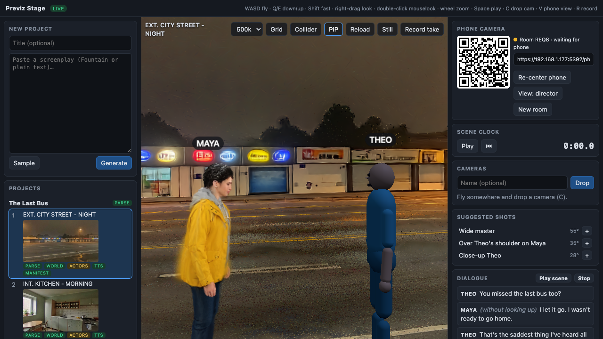

## How a filmmaker uses it

Previz Stage is for a director, a DP or a film student who has a script and a shoot coming up.
Before anyone builds a set, books a location or calls the actors, you want answers to four
questions: does the scene work on its feet, where does everyone stand, what are the shots, and how
do I show the crew? The laptop is laid out in exactly that order:

**Script → Scenes → Blocking → Coverage → Shoot → Share**

The right panel has three modes, **Scene · Shots · Camera** (Tab steps through them), the top bar
has an **Export** menu, and everything more technical lives under **Tools** (`T`): grading,
re-prompting, the object outliner and developer details.

1. **Script.** Paste the screenplay into the project chat and press Send. The breakdown comes back
   as a plan card: the cast with their descriptions and heights, the locations, day or night, the
   film's genre and era, and every line of dialogue. Nothing has been spent yet, so this is the
   moment to fix things in plain words ("Theo is older, mid-fifties", "make the style a western")
   or attach photos of the real people and places. When the plan reads right, press **Generate**.
2. **Scenes.** Each scene builds in the background (parse, world, actors, voices, manifest) with a
   progress bar in the drawer, and the first one opens on its own as soon as it is ready. It opens
   already graded with the look the planner chose, and the **Scene** mode names it
   (`Sc 1 · EXT. FRONTIER TOWN MAIN STREET - DAY`, also in the top bar). The moods are a row of
   named swatches with the planner's pick marked; one click tries another, and nothing you do
   there loses your lights or lens.
3. **Blocking.** The cast stands on the marks the planner wrote, already moved out of walls and
   onto the visible ground. Drag anyone to a new mark, turn them with the ring, check their height,
   pose and eye line in the cast list, and use **Back to mark** when you have gone too far. Click a
   line to hear it spoken from where that actor stands, or **Play scene** to run the whole scene:
   the dialogue in order, the actors' timed actions (walking in, sitting down, turning to watch),
   and the background action, each moving prop with its own on / off switch.
4. **Coverage.** The **Shots** mode is a numbered shot list (1A, 1B…) seeded with standard
   coverage framed on where the cast actually stands: a wide master, a two-shot, over-the-shoulders
   and a close-up per actor. Each shot has a frame grab, a lens in mm, the camera height, a note and
   the lines it covers. Press **C** to add the current view as a shot, **1–9** to jump between shots
   behind a 16:9 or 2.39 frame guide, and rename, re-lens or reorder anything. The list is saved
   with the project, so it is there when you come back.
5. **Shoot.** In **Camera** mode, scan the QR code with a phone and it becomes the handheld camera
   on the selected shot. Hold it up, press **ACTION**, and the actors play the scene around you
   while you find the frame. Every take is recorded with the dialogue and lands in the Takes list to
   play back or download.
6. **Share.** **Export** composes a storyboard sheet of the scene's frames, each with its shot
   number, lens, camera height and lines, as a PNG or a print page you can save as a PDF. The shot
   list for every scene downloads as a CSV that drops straight into a shooting schedule.

| | |
| --- | --- |
| 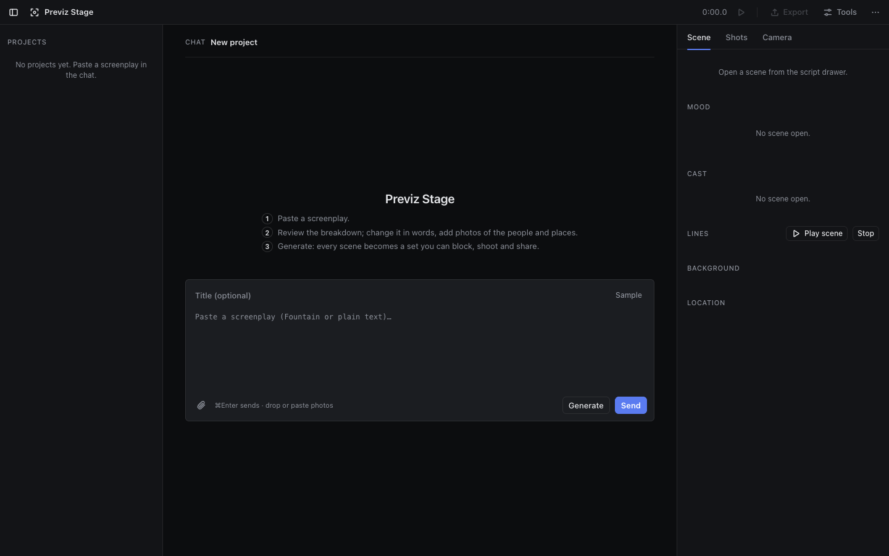 | 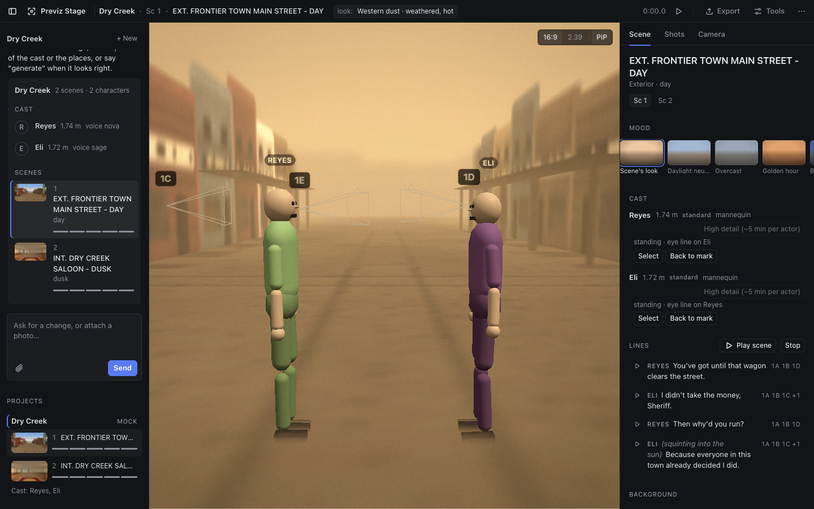 |
| 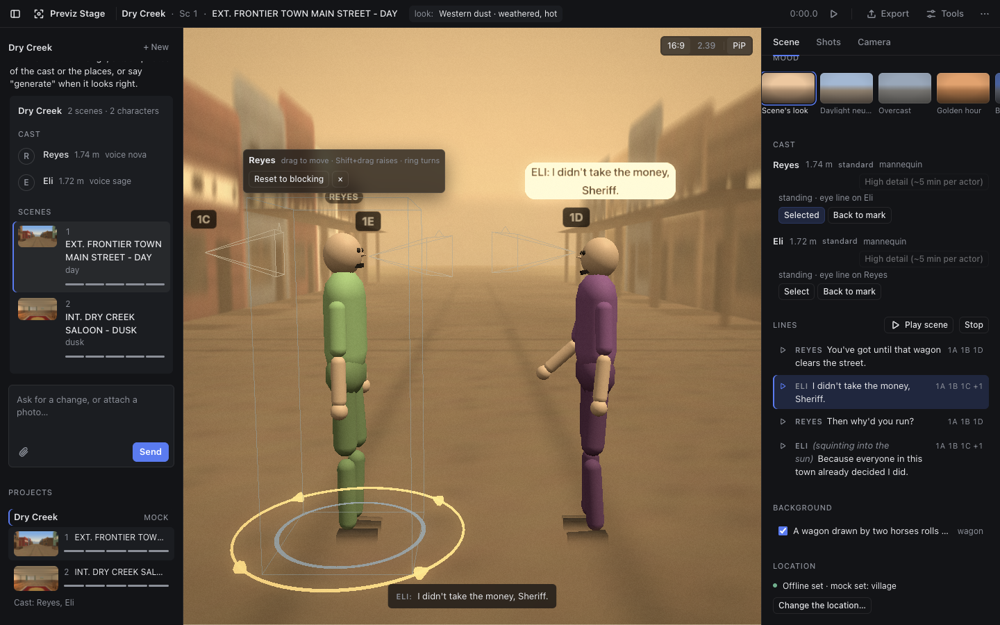 | 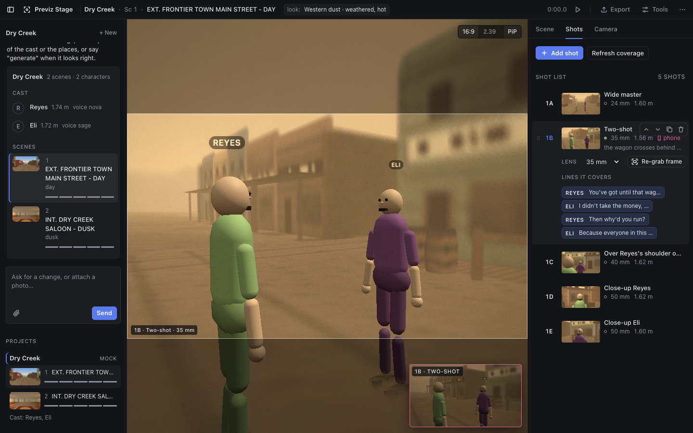 |
| 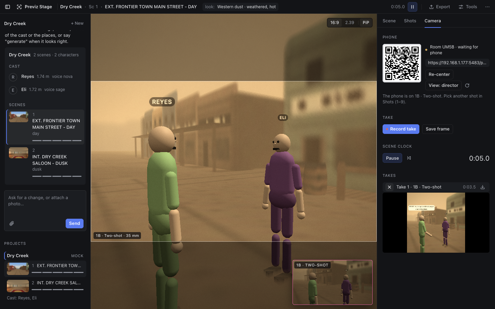 | 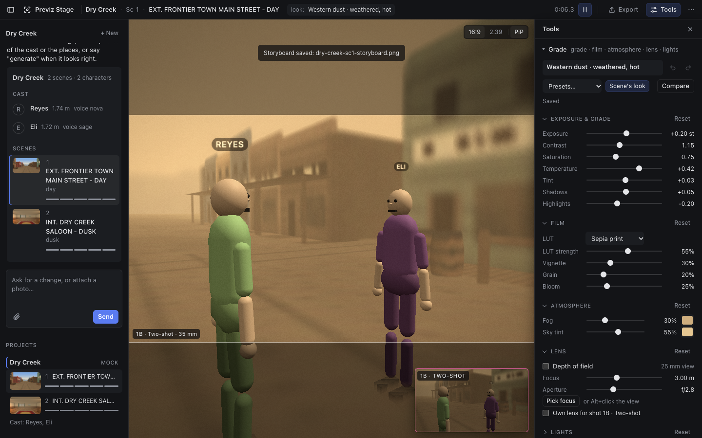 |

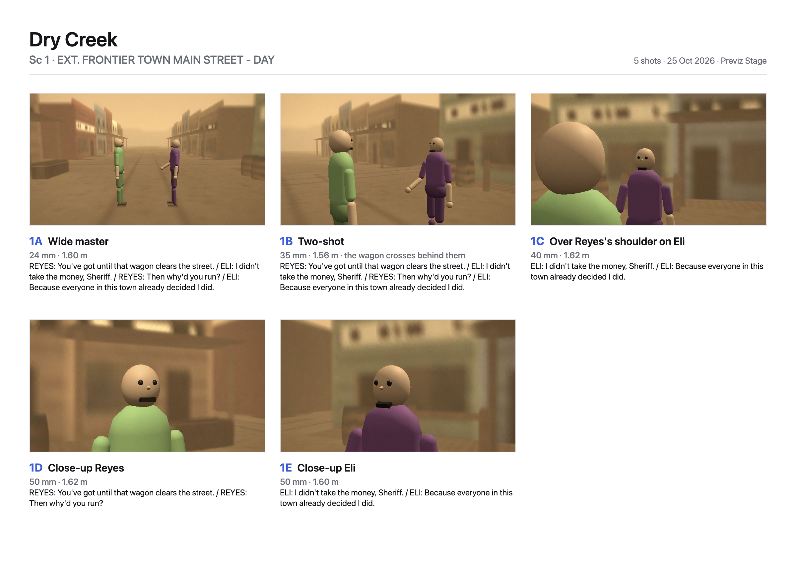

## Architecture

```
 screenplay (.fountain / text)
        │  POST /api/projects
        ▼
 server/pipeline/  ── per project, every stage idempotent and resumable after a restart ─────────┐
   screenplay.ts   Claude (claude-opus-5-5) → ScreenplayPlan: scenes, characters, dialogue,     │
                   blocking, moving props, suggested shots           (offline parser in MOCK)  │
   marble.ts       world prompt → Marble text→world, receipt-first (a crash never pays twice)   │
                   ↳ world-library.ts: reuse data/marble/<slug without INT./EXT.>              │
   actors.ts       description → OpenAI reference image → LHM on Modal L4 (worker/) →          │
                   splat avatar + runtime rig; any failure → procedural mannequin (fallback)   │
                   "High detail" per character: LHM-1B + fine-tune → actors/<id>/high/         │
                   ↳ actor-library.ts: reuse data/actors-library/<characterId>                 │
   tts.ts          each line → mp3 (ElevenLabs or OpenAI gpt-4o-mini-tts); beeps offline       │
   project.ts      orchestration → <DATA_DIR>/<id>/scene-<n>/manifest.json (shared/schema.ts) ─┘
        │
 server/index.ts   one HTTPS origin: Vite (dev) + /api + /projects/* assets + /cert.pem + wss /ws
 server/relay.ts   rooms: laptop ⇄ relay ⇄ phones (shared/protocol.ts)
        │                         ▲ PhonePose ≤ 30 Hz (relay stamps phoneId)
        ▼                         │ SceneState (scene, clock, cameras, speaking line), commands
 web/  (three.js + Spark)         │
   /              laptop director: project chat, scene list + pipeline bars, Scene / Shots / Camera
                  modes, shot list with frames, phone frustum + picture-in-picture, dialogue
                  playback, take recorder, storyboard / CSV export, Tools drawer
   /phone.html    phone camera: sensors → pose, renders the same scene from the phone's pose
   viewer/        shared loader: SPZ world (Marble OpenCV → metric, floor at y = 0), collider,
                  actors (rigged LHM avatars performing shared HY-Motion clips, skinned on the
                  GPU; baked splat sequence; mannequin), props on looped paths, placement fix-up
```

Contracts between the pieces live in `shared/` (`schema.ts`: plans and manifests, `protocol.ts`:
the WebSocket messages, `api.ts`: routes). `docs/PLAN.md` has the design notes.

## Setup

Requirements: Node 22+ (developed on 24), pnpm, a laptop and a phone on the same
Wi-Fi. Python 3 with `modal` is needed only for real LHM avatars (see `worker/README.md`).

```sh
pnpm install
cp .env.example .env.local      # then fill in what you have (all optional, see below)
pnpm dev                        # https://localhost:5173 (PORT=…) — the phone URL is printed too
```

| Variable | Used for | Without it |
| --- | --- | --- |
| `ANTHROPIC_API_KEY` | screenplay → scene plan (Claude) | offline rule-based parser |
| `WLT_API_KEY` | Marble worlds | mock world (a small procedural set that fits the scene heading, see `fixtures/mock-world/README.md`) |
| `OPENAI_API_KEY` | actor reference images, TTS | mannequin actors, beep audio |
| `ELEVENLABS_API_KEY` | preferred TTS when set | OpenAI TTS |
| `MODAL_TOKEN_ID` / `MODAL_TOKEN_SECRET` | LHM avatars on a Modal L4 | mannequin actors |
| `MOCK=1` | everything offline from `fixtures/` (what the tests use) | live mode |
| `MARBLE_MODEL` | `marble-1.1` (default), `marble-1.0-draft`, `marble-1.1-plus` | |
| `MARBLE_DRY_RUN=1` | log the exact Marble request instead of sending it; mock world (the set that fits the heading) | |
| `WORLD_LIBRARY_DIR` / `ACTORS_LIBRARY_DIR` | reuse folders (default `data/marble`, `data/actors-library`) | |
| `DATA_DIR`, `PORT` | project store (default `data/projects`), port (5173) | |

Keys are read only by `server/env.ts`, never logged, and `/api/health` reports presence only.
The header badge says `MOCK` or `LIVE`; hover it to see which keys are set.

## Make a scene

1. Open `https://localhost:5173/` and accept the self-signed certificate once.
2. In the project chat (it fills the viewport while no scene is open), paste a screenplay (or
   press **Sample**) and press **Generate**. The project appears in the drawer (left; its button
   or `[` toggles it) with one row per scene and a thin five-segment bar for its pipeline (parse,
   world, actors, tts, manifest) that names the stage while it runs or after it failed. Hover a
   segment for the detail; a red (failed) or amber (fallback) segment, or the "… failed · retry"
   label, can be clicked to retry.
3. The first ready scene opens on its own; click any ready row to switch.
4. The **Scene** mode (right panel) names the scene, steps through the project's scenes, offers the
   moods, and lists the cast: one row per character with its height (`1.80 m`, see
   [Actor heights](#actor-heights)), build detail (`standard` / `high`), kind (`avatar` /
   `mannequin`), a `fallback` flag, pose and eye line. **High detail (~5 min per actor)** rebuilds
   that character with LHM-1B plus a fine-tune against its reference image (see below). The world's
   splat quality, measured scale and floor offset are in **Tools › Developer**.

## High detail actors

The standard actor is LHM-500M from one generated reference photo: right silhouette, soft face
and clothing. **High detail (~5 min per actor)** in the project panel (tooltip: "LHM-1B +
fine-tune against the reference. About 5 minutes and ~$0.20 per actor on Modal; the current build
stays until the new one lands.") in the Scene mode's cast calls `POST /api/projects/:id/actors/:characterId/rebuild
{detail: 'high'}` (202). The server runs `worker/run_actor.py --detail high` in the background into
`<project>/actors/<id>/high/`; the cast row's status reads `rebuilding Leo · ~5 min · 1:23` with the elapsed
time. When the build lands, every scene manifest showing the character is rewritten to it
(`detail: 'high'` on the ActorAsset), an existing `data/actors-library/<id>/` copy is refreshed
(the previous one kept as `sequence.previous/`), and the open scene swaps that actor in place:
camera, clock and the other actors stay, and a paired phone reloads the scene. A failure changes
nothing but that status (`high detail failed`, with the reason and **Retry high detail**); a retry
or a server restart recovers the Modal call from its receipt instead of paying again. **use
standard** switches back to the standard build, which is kept on disk (no GPU).

Measured on LEO in `the-last-bus` (one real rebuild through the route): 123 s of L4, about $0.05
(the button's ~5 min / ~$0.20 is a conservative upper bound). The difference is visible: the
face, hair and stubble are sharper and match the reference photo, and the coat's wet creases come
through. The cost is pale streaks when the face is seen from far to the side.

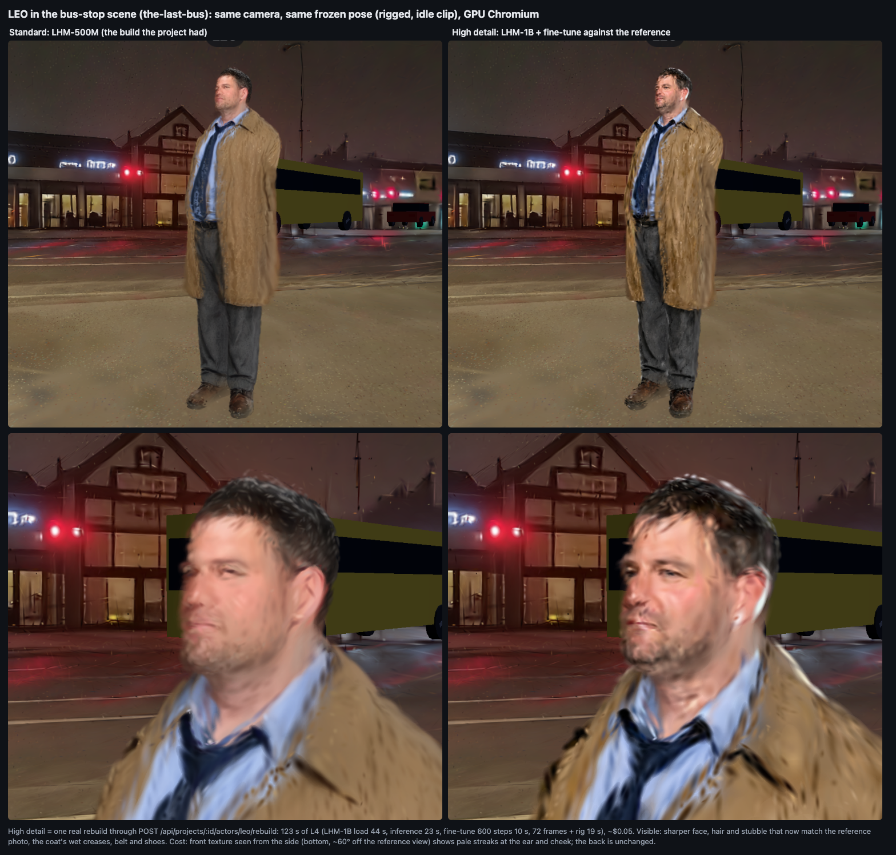

Method, the artefacts that shaped it, and the numbers are in `worker/README.md` ("High detail").

## Actors that do things (beats)

Each character's blocking can carry **beats**: timed actions on the scene clock that Claude writes
from the action lines, the parentheticals and the dialogue timing ("hurries up beside Maya, out
of breath" → a walk to a new mark at t 0; "steps a half pace closer" on his sad line; "turns
with her to watch the bus"). A beat can walk the actor to a mark (`moveTo`), sit or stand them
(`pose`, or read from the action), and turn them (`yaw`). `shared/beats.ts` turns the beats into
where the actor is, which way it faces and whether it stands, sits or walks at any scene time, so
pressing Play, scrubbing or filming a take from the phone all see the same performance. Rigged
avatars walk with their walk cycle locked to the distance covered (no foot sliding), stand up
before walking off a seat, cross-fade into standing on arrival and turn at about half a turn per
second; mannequins swing their legs in place while they move. When placement correction or a
"move Leo closer" edit moves an actor, the whole choreography moves with its starting mark.
Older plans without beats behave as before.

**Gestures.** A beat that is a distinct on-the-spot action ("throws up her hands", "rubs his
eyes") also carries a `gesture`: a short text-to-motion prompt Claude writes. The manifest stage
turns it into a `clip` the actor plays once from the beat's start, locked to the scene clock
(scrubbing works), then cross-fades back to idle or talking; walking off ends it.

- `MOTION_GEN=1` (live, Modal key): every new prompt is generated with HY-Motion 1.0 on a Modal
  L40S (`worker/motion_library.py --gestures`, one GPU call for all new prompts in a scene),
  turned into a one-shot clip (warm-up trimmed, facing +Z, the actor ends where it started, the
  steadier of two seeds), cached by prompt in `data/motion-library/gestures/` (`MOTION_CACHE_DIR`)
  and merged into `scene-<n>/motion/motion-library.json`, which the manifest points at. A prompt
  is generated once, ever; later scenes and projects reuse it.
- Otherwise (MOCK, no Modal key, or a failed generation): the nearest clip the actor already ships
  with, by keyword (a shrug or a question → `talk-2`, pointing or explaining → `talk-1`, nodding or
  watching → `idle-listen`, seated variants when sitting), or none.

## Reference photos: build the actor, generate the world from the director's picture

A photo attached in the project chat becomes `Character.referenceImage` (a person) or
`ScenePlan.worldReference` (a place); the pipeline then uses it instead of the text alone:

- **Actor** (`server/pipeline/actors.ts`): the upload is copied to `actors/<id>/reference-source.<ext>`
  and normalised into the LHM-ready `reference.png` with OpenAI `images/edits` (gpt-image-1.5,
  `input_fidelity: high`, 1024×1536: the same person standing full-body and front-facing on a plain
  background), then built with LHM as usual. Without an OpenAI key, or in MOCK, the photo itself
  stands in (a JPEG / WebP converted with `sips` or Pillow, letterboxed to a portrait). A photo
  character never takes the actors-library avatar of the same id, and the library is never
  refreshed from it. `reference.json` (which photo `reference.png` came from), `build-source.json`
  (which reference a sequence / Modal receipt belongs to) and `referenceSha` in `actor.json` keep a
  new photo from reusing or recovering the previous person's build; a High detail rebuild reuses
  the normalised reference.
- **World** (`project.ts` world stage, `marble.ts`): the photo is Marble's image prompt with the
  scene's world prompt as its text, never a library world. Marble takes PNG only, so a JPEG / WebP
  is converted once into `scene-<n>/world-reference/<sha>.png` (else the text prompt is used, with
  a note). The receipt's `promptSha256` hashes the photo too: a new photo is a new world, the same
  photo + prompt is never generated twice.
- **After a change on a live project** the chat calls `ProjectStore.regenerateWorld(id, n)` (the
  re-prompt regen machinery: the new world is built in `scene-<n>/regen/<key>/world/`, the old one
  kept as `world.prev-<k>/`, calibrated and ground-measured like any world; look / actors / props
  stay, region edits are dropped with a note; a world already generated from that photo is swapped
  back in for free) and `ProjectStore.rebuildActorFromPlan(id, characterId)` (the build moves
  into `actors/<id>/prev-<k>/`, the manifests show it until the new build lands; a height-only
  change just rescales the same person, no GPU). Both show progress on the world stage / the
  cast's rebuild status, are idempotent while running and resume after a restart.

The laptop shows the photo next to the character in the Scene mode's cast and next to the Marble
thumbnail in the projects drawer. One live run on `fixtures/real-samples/reference-512.jpg` (a
generated person standing in for the director's photo): about $0.10 for the image edit and $0.036
of L4 (87 s), 330 s wall clock.

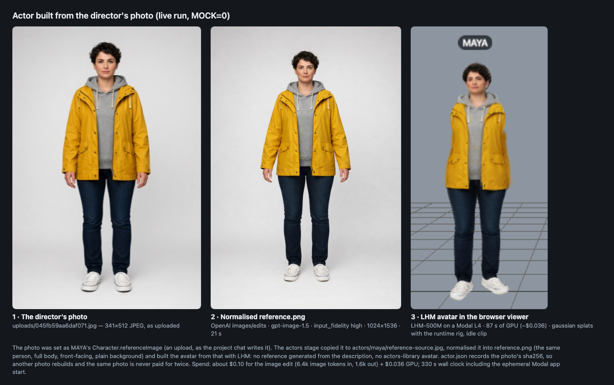

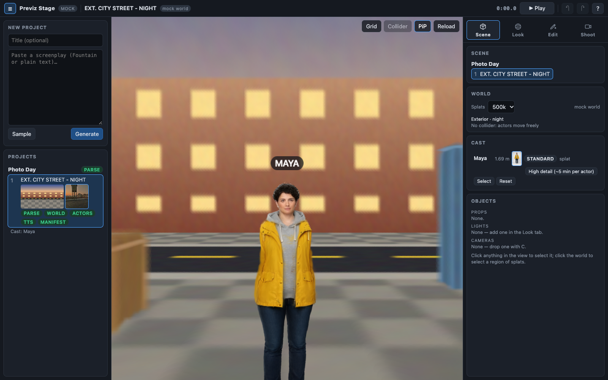

Under `MARBLE_DRY_RUN=1` the world from a photo logs the exact requests and gets the mock world:

```text
[scene 0] world: your photo uploads/16d81435102e39f1.webp: WEBP → PNG via sips for the Marble upload
[scene 0] world: marble: DRY RUN (MARBLE_DRY_RUN=1), not uploaded: POST …/marble/v1/media-assets:prepare_upload
  {"file_name":"16d81435102e39f1.png","kind":"image","extension":"png"} + PUT 260293 bytes
[scene 0] world: marble: DRY RUN (MARBLE_DRY_RUN=1), not submitted: POST …/marble/v1/worlds:generate
  {"display_name":"Photo Day · EXT. CITY STREET - NIGHT","model":"marble-1.1","world_prompt":{"type":"image",
   "image_prompt":{"source":"media_asset","media_asset_id":"<dry-run: not uploaded>"},"is_pano":false,
   "text_prompt":"Photorealistic exterior city street, … No people, no vehicles.","disable_recaption":true},
   "permission":{"public":false}}
```

## Look development

**Tools › Grade** grades the open scene, and the paired phone renders the same frame (the Scene
mode's mood swatches apply the full-look presets in one click).
Groups: **Exposure & grade** (exposure in stops, contrast about mid grey, saturation, white-balance
temperature / tint, shadows, highlights), **Film** (LUT preset + strength, vignette, animated
grain, bloom), **Atmosphere** (fog colour + density, sky tint), **Lens** (depth of field: focus
distance, f-stop; **Pick focus** or Alt+click the view focuses on the splat under the cursor) and
**Lights** (up to four point / spot / sun lights with colour, intensity, radius, cone, position,
**Place at camera**; "Scene light" scales the captured lighting). The header has a name, presets
(twelve LUTs and eighteen looks in three groups, plus **Scene's look**, the planner's suggestion), undo / redo
(⌘Z / ⇧⌘Z, 50 steps), per-group **Reset** and a **Compare** button that shows the ungraded frame
while held. A shot can get its own lens ("Own lens for shot …"); the phone attached to it uses
that lens.

Every change renders on the next frame and is saved to `scene-<n>/edits.json` 300 ms after the
last one (`GET / PUT /api/projects/:id/scenes/:n/edits`, revision-checked). While a change is
unsaved the look rides in `SceneState.look` (8 Hz while dragging), then `editsRevision` tells the
phone to fetch the file. The phone shows the look's name when it changes. Stills and takes capture
the graded frame.

How it renders (`web/src/viewer/look/`): the grade, LUTs, vignette, grain and bloom are one post
pass. The view is rendered into a target that holds exactly the canvas's bytes, so an ungraded
scene is unchanged (it skips the pass and renders straight to the canvas). Lights, fog and sky
tint are a Spark world modifier that recolours each splat, plus three.js lights and fog for
meshes. Depth of field is Spark's own (aperture from f-stop and the camera's focal length).

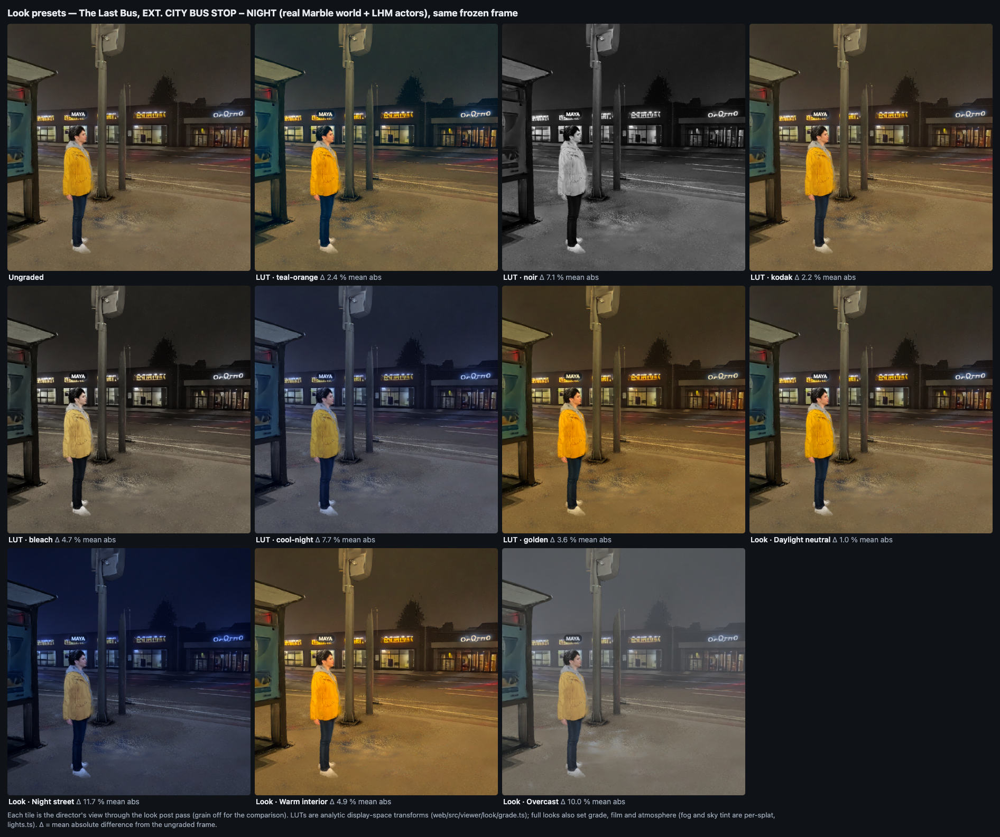

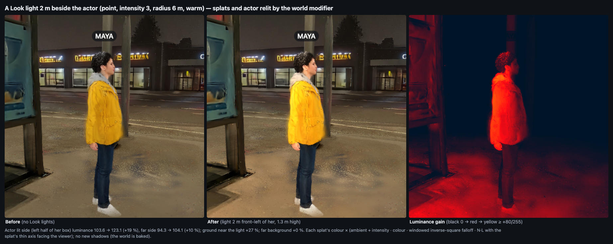

## Genres: style, looks, sets and props

A fantasy, science-fiction, horror, western or period screenplay comes out looking like one
without the director touching a slider. The planner names the film's style, every scene opens
graded with a look chosen for it, MOCK mode shows a set that fits the heading, and action lines can
bring a dragon, a stagecoach or a drone. Five fixture screenplays (`fixtures/genres/*.fountain`)
exercise it; `tests/e2e/genres.spec.ts` runs the fantasy one end to end.

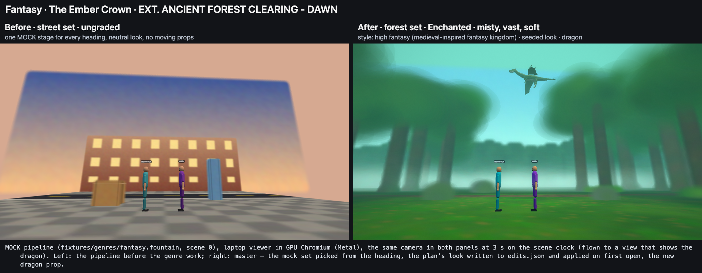

**Style and look seed.** The plan carries `style` (`genre`, `era`, `worldStyle`, `palette`: a few
words each, once per screenplay) and every scene a `look` seed: one of the eighteen presets, optional
adjustments in Look units (exposure, contrast, saturation, temperature, tint, LUT, vignette, grain,
bloom, fog, sky tint) and mood words for the name. The Claude planner picks the style first, writes
every world prompt in that register ("Lush, painterly-realistic … fantasy still of …"), and chooses
each scene's look from its time of day, interior, weather and mood. The offline planner uses
keywords: two hits decide the genre (dragon, sword, crown → high fantasy; station, orbit, airlock →
science fiction; cellar, scream, blood → horror; saloon, sheriff, wagon → western; ballroom,
carriage, a decade such as "1890s" → period drama; else contemporary). Then rules pick the look:
snow or storm outside first; an interior at night is candlelit in fantasy, western and period,
warm interior otherwise; night outside is a night street (contemporary) or moonlit; a fantasy forest
is enchanted; dusk is golden hour; a western day is western dust; horror and science fiction have
their own. Mood words come from the action ("misty", "firelit", "sodium-lit"). Actor reference
prompts add one sentence with the genre and era, so the cast's wardrobe agrees. A plan made before
looks existed gets one derived the same way from the heading, time of day, interior and action
(`lookSeedFor` in `server/pipeline/look-seed.ts`). The live bus stop gets "Night street · damp,
sodium-lit" this way.

What the Claude planner wrote for scene 0 of two fixtures (`cli parse`, about $0.05 each):

| Fixture | Genre · era | Look seed | World prompt (first 120 characters) |
| --- | --- | --- | --- |
| fantasy | high fantasy · medieval-inspired kingdom | `enchanted` "misty, hushed, pale gold dawn", temperature +0.2, fog `#d8dccb` 0.2 | Lush, painterly-realistic cinematic fantasy still of an ancient forest clearing at dawn: colossal moss-covered tree trunks |
| sci-fi | hard science fiction · 2090s Earth-orbit station and lunar outpost | `cold-steel` "cold, sterile, uneasy hush", vignette 0.35 | Photoreal cinematic film still of a long orbital station cargo deck: brushed steel floor plates with grip grating, cold whi |

Scene 1 of the sci-fi fixture (EXT. LUNAR LANDING FIELD - DAY) shows the adjustments at work:
`daylight-neutral` with contrast 1.3, saturation 0.7 and a black sky tint at full strength for an
airless sky.

**The first open is graded.** When the manifest stage writes a scene and `scene-<n>/edits.json`
does not exist yet, it writes one with the seeded look, `revision 1`, and the history entry
"suggested look from the plan". An existing edits.json is never touched: the director's grade
always wins. The laptop's top bar shows the name (`look: Enchanted · misty, vast, soft`), and the
phone shows it as a toast. The Scene mode shows the eighteen looks as swatches (the planner's
marked); in Tools › Grade they are grouped Daylight / Night & interiors / Genre. **Scene's look** (a button, and the first entry of the presets list) goes back to
the plan's suggestion and keeps the director's lights and lens. It is lit while the look on screen
is the plan's.

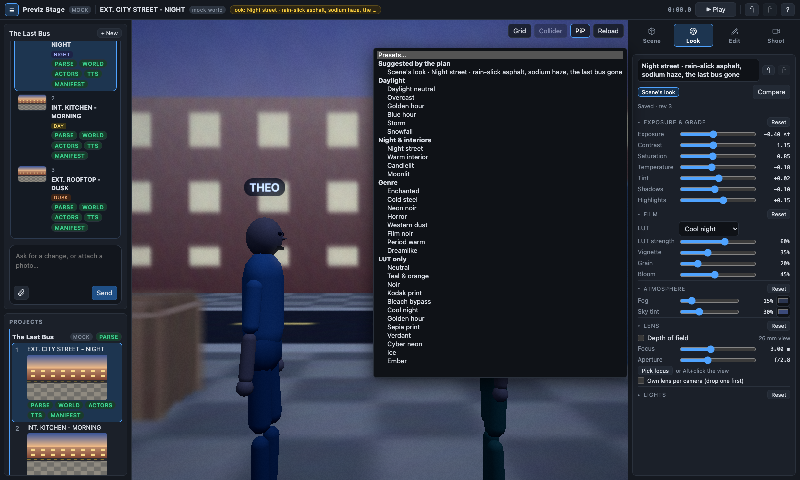

**Chat.** "make the style a western" (also "genre: fantasy", "the whole film as a horror") sets
`style.*` to that genre's style. That is a plan change only and costs nothing; worlds that are
already generated stay as they are. "scene 2 look candlelit" (or "scene 1 look: golden hour")
sets that scene's `look.preset`. On a generated scene with an edits.json the grade changes at once
(the same path as `cli look --write`); otherwise the manifest stage seeds the new look. The plan
card shows the style line, each scene's look and its background action. "add a dinosaur walking by
in scene 1", "an airplane flies low overhead in scene 2" and "remove the dinosaur" change a scene's
background action (see Dynamic scenes below).

**`cli look`.** Prints the scene's look seed and the name it gives. `--write` puts it into an
existing project: it replaces edits.json's look and keeps the edits, the history (one entry added)
and the director's lights and lens; the revision goes up by one. `--preset <name>` swaps the preset
and keeps the mood words. There is no network call.

```sh
pnpm tsx server/pipeline/cli.ts look data/projects/the-last-bus-abcb17 0 --write
# EXT. CITY BUS STOP - NIGHT: derived from the heading (plan.json has no look)
# look name: Night street · damp, sodium-lit   → scene-0/edits.json revision 2
```

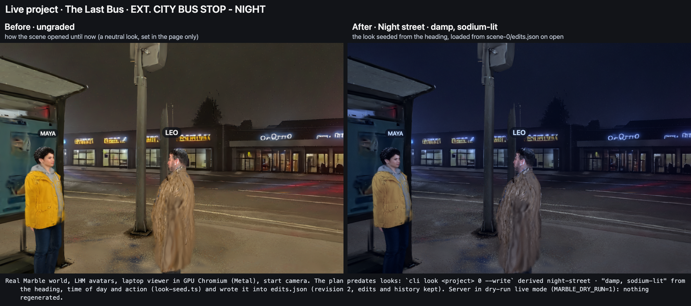

The whole laptop on that project, with the look badge in the top bar:
[live-bus-stop-look-after.png](docs/images/live-bus-stop-look-after.png).

**Mock sets.** MOCK mode, a missing `WLT_API_KEY` and `MARBLE_DRY_RUN=1` (plus the dry-run and
Edit-tab regenerations) use one of ten small procedural sets instead of one street for everything:
`street`, `forest`, `hall`, `cave`, `desert`, `station`, `shore`, `village`, `room`, `field`
(`fixtures/mock-world/README.md`). `pickMockSet(scene, style)` reads the heading first. Its keywords
are tried in a fixed order and the first rule that fits the interior flag wins: "THRONE HALL" is the
hall, "FARMHOUSE CELLAR" the cave, "LUNAR LANDING FIELD" the desert, "ORBITAL STATION - CARGO DECK"
the station, and "SALOON" is the village outside and a room inside. A heading without a keyword
falls back to the world prompt, where a set needs two hits. With nothing matched, an interior is a
room (a station in science fiction) and an exterior is the street (a village lane in fantasy,
western and period). The chosen set is in the world caption (`mock set: forest`) and the stage note.
`pnpm tsx server/pipeline/cli.ts make-mock-world [set|all]` rebuilds them.

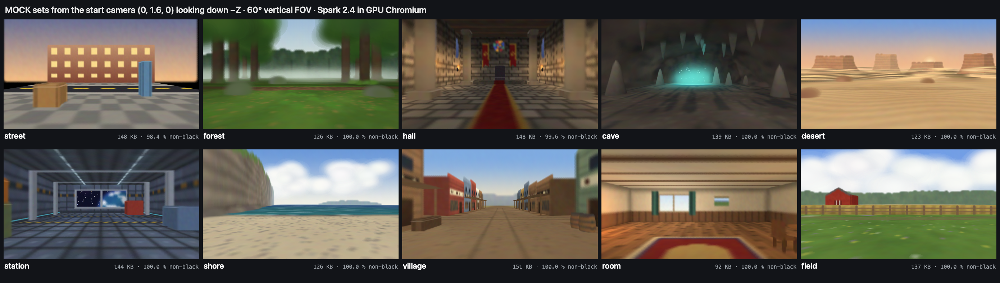

**Props for any era.** Besides car, bus, bicycle, bird and pedestrian, the planners can now ask for
`truck`, `motorcycle`, `dog`, `horse`, `wagon`, `boat`, `dragon`, `drone`, `spacecraft`, `airplane`,
`helicopter` and `creature`, so any creature or vehicle can be asked for by description: a dinosaur,
a herd of elephants, a wolf pack or a troll is a `creature`, any fixed-wing aircraft an `airplane`
(the closest kind otherwise, `generic` only as a last resort). Each is built from primitives in the
label's colour (`web/src/viewer/props.ts`, `props-more.ts`, under about 3k triangles). Some label
words change the model:

| Kind | Label words | Variant |
| --- | --- | --- |
| horse | rider, rides, horseback, mounted, cavalry, knight, cowboy … | a seated rider |
| horse | gallop, charge, race, stampede … | gallop instead of walk |
| wagon | stagecoach, coach, carriage, landau, hansom … | closed stagecoach cabin |
| wagon | covered, canvas, conestoga, prairie schooner | canvas cover (else an open bed) |
| boat | sail, yacht, schooner, sloop, galleon … | sails (else a cabin) |
| airplane | airliner, jet, fighter, biplane, propeller / light aircraft, seaplane | airliner (~31 m, the default), fighter jet with afterburner, biplane, high-wing prop plane, floats |
| helicopter | police, news, rescue / medical, military, black hawk | livery colours |
| creature | the species: dinosaur, t-rex, raptor, triceratops, brachiosaurus, elephant, mammoth, giraffe, rhino, bison, bear, wolf, deer, moose, lion, tiger, cow, bull, sheep, goat, cat, kangaroo, ostrich, crocodile, troll, ogre, giant, yeti, cyclops, monster … | quadruped (body, neck, head, tail, four legs), biped dinosaur (big tail, short arms), hopping kangaroo, ostrich, upright giant; horns, antlers, trunk, frill, plates, stripes, spots, mane by species or label |
| creature | huge, giant, massive · small, little, baby · herd, pack, two | 2× · 0.5× · three (two) of them |

The wagon is drawn by two harnessed horses with a driver. The motorcycle leans into turns and the
boat bobs and rolls at its waterline. The dragon's wings flap, its neck and tail wave, and its
wingspan is about 11.8 m. Flyers (bird, dragon, drone, spacecraft, airplane, helicopter) keep their
path's height and pitch and bank with their own motion; an airplane's gear is down only near the
ground, a helicopter bobs while it hovers (speed 0), and a creature's legs cycle with distance while
its head, tail and breathing move with time, also when it stands. `web/src/viewer/dev/props-gallery.html`
shows every kind and variant.

**Dynamic scenes.** Every moving thing in the action lines becomes background action, never
dropped; an animal that only stands or grazes there is kept too. The offline parser and the Claude
planner share the words and the paths (`server/pipeline/dynamics.ts`): a creature walks on the
ground behind the actors, 6-10 m out (a big one ~10 m), across the view at 2.5-4 m/s (a dinosaur
3), or stands; an airplane flies 20-40 m up at 25 m/s, "overhead" / "low" along the view over the
actors' heads, else across the sky, take-offs and landings to the ground; a helicopter flies
10-20 m up at 12 m/s, circles, lands, or hovers (one spot, speed 0). The chat changes a scene's
background in words: "add a dinosaur walking by in scene 1", "an airplane flies low overhead in
scene 2", "add a helicopter hovering over the street in scene 1", "remove the dinosaur". That is a
free `dynamics` plan patch (`server/pipeline/chat/patch.ts`); on a generated scene the manifest is
rewritten from the plan (world, actors and audio as they are) and an open scene swaps its props
live, the paired phone reloads it. The plan card lists each scene's background, and Tools ›
Re-prompt knows the same words ("add a dinosaur walking by").

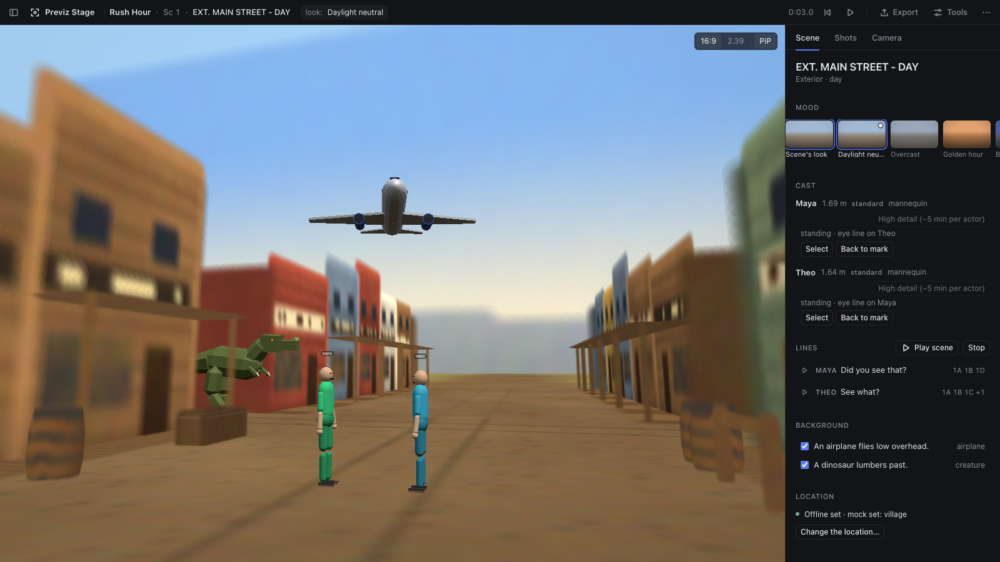

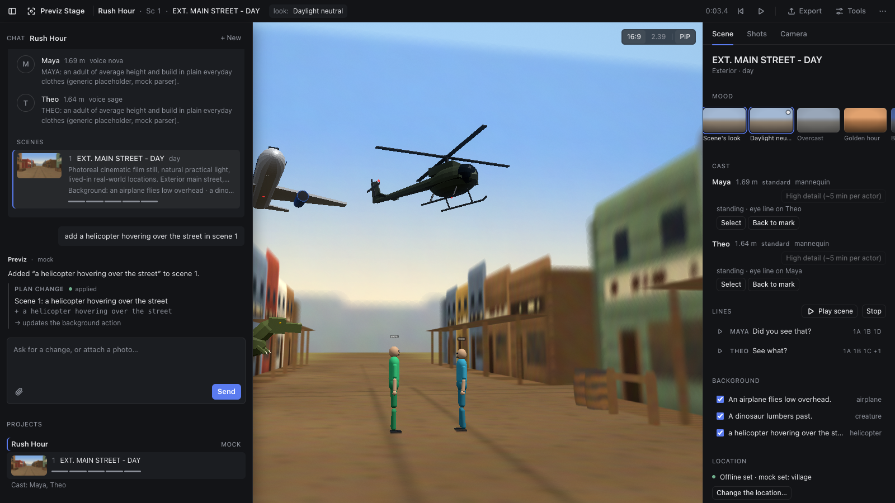

The Claude planner (`cli parse`, one call, ~$0.07) on "A dinosaur lumbers past. An airplane flies
low overhead.": `creature` "a huge dinosaur lumbers past down the street" from (-16, 0, -9.5) to
(16, 0, -9.5) at 3 m/s, and `airplane` "an airliner flies low overhead" from (-40, 22, -150) to
(20, 22, 60) at 25 m/s.

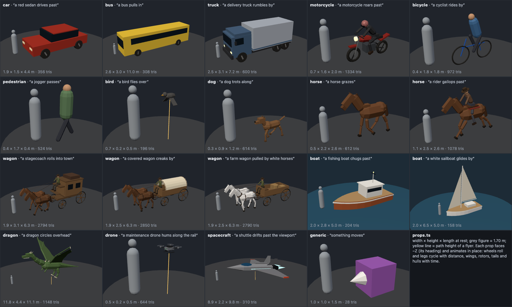

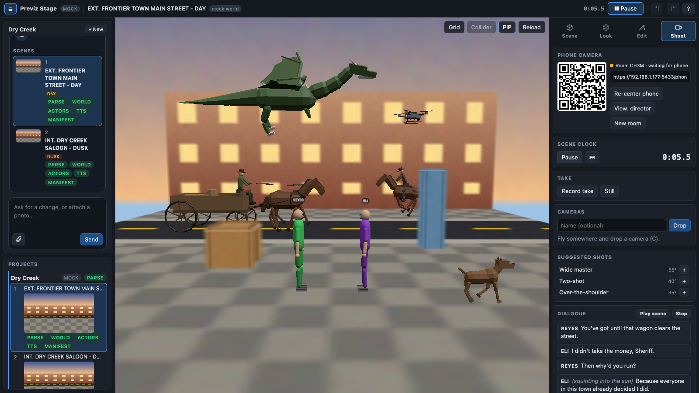

**Evidence.** Each genre in MOCK, the pipeline before this work (the street set for every heading,
neutral look) against master. Same scene, same camera, laptop viewer in GPU Chromium:

| Genre · scene | After |
| --- | --- |
| [Fantasy · forest clearing, dawn](docs/images/genre-fantasy-before-after.png) | forest set · Enchanted · misty, vast, soft · a dragon overhead |
| [Fantasy · throne hall, night](docs/images/genre-fantasy-hall-before-after.png) | hall set · Candlelit · vast, firelit, weathered |
| [Science fiction · cargo deck, night](docs/images/genre-scifi-before-after.png) | station set · Cold steel · a drone on the ceiling rail |
| [Horror · farmhouse cellar, night](docs/images/genre-horror-before-after.png) | cave set · Horror · decaying, damp, dark |
| [Western · frontier main street, day](docs/images/genre-western-before-after.png) | village set · Western dust · weathered, hot · a wagon |
| [Period · grand ballroom, night](docs/images/genre-period-before-after.png) | hall set · Period warm · opulent, lonely |

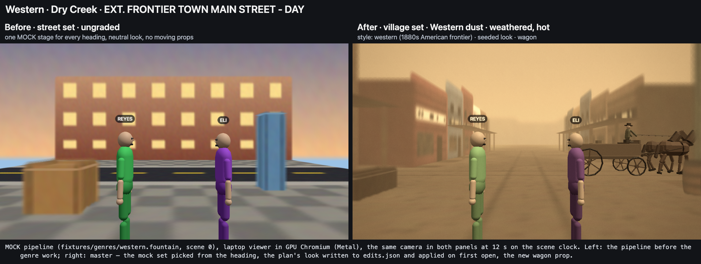

On the four real Marble worlds, the look the pipeline seeds for each heading: night street for
the city street and the bus stop, warm interior for the kitchen, golden hour for the rooftop.
`docs/images/genre-presets-*.png` shows every preset on each world.

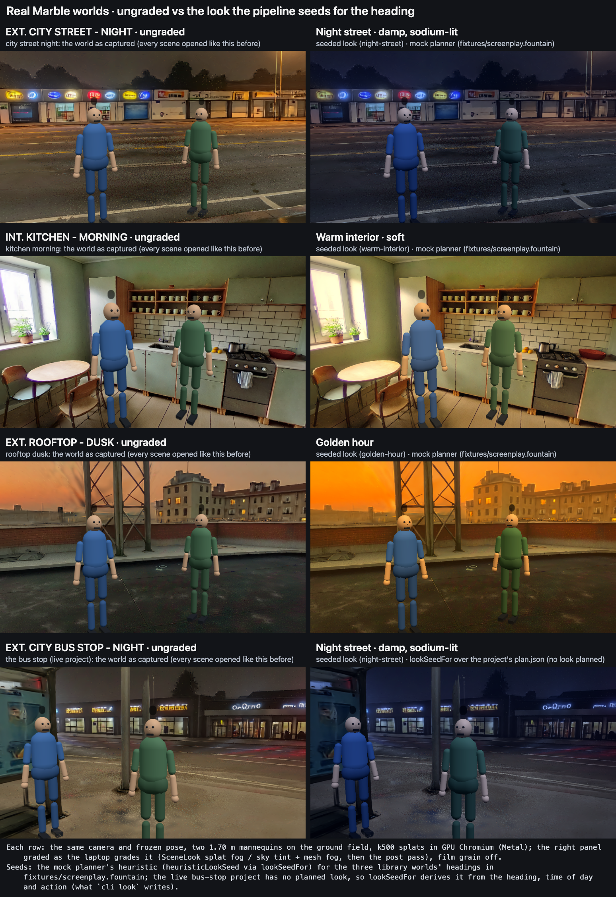

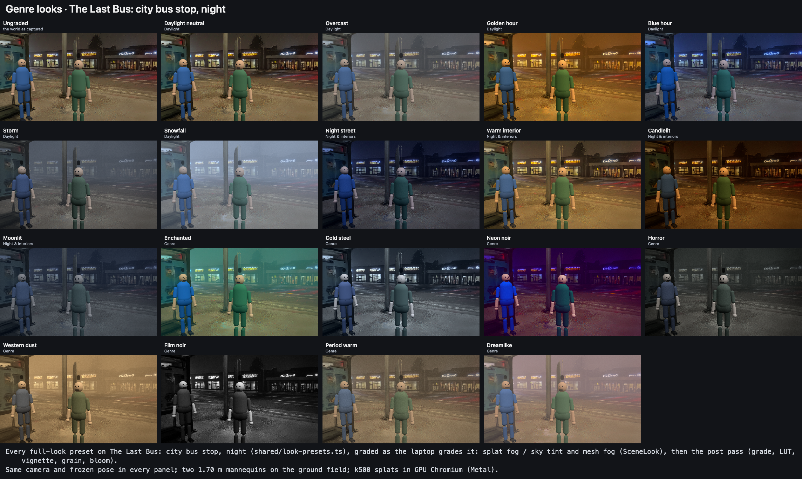

### Props: import or generate

Scene › Background › **Add prop** puts the director's own object in the scene, next to the
planner's background action:

- **Import a 3D model (.glb)**: pick a file, or drop it on the view. It is uploaded to the
  project (`POST /api/projects/:id/uploads` with `model/gltf-binary`, ≤ 25 MB, stored once per
  content as `uploads/<sha16>.glb`). The server checks the container ('glTF' magic, version 2,
  length, JSON chunk) and refuses Draco, meshopt and KTX2-compressed files with the reason (the
  viewer bundles no decoders). The model keeps its own size when that is plausible (glTF units are
  metres; 2 cm to 100 m), else it stands 1 m tall.
- **Generate from a description…**: type "a weathered wooden barrel" and Go. A row shows the job
  ("Generating: a weathered wooden barrel · meshing on Modal…", polled every 2 s); when it is done
  the prop is placed with a toast, and a failure shows the error with **Retry**. The server
  (`server/pipeline/props.ts`, `POST …/props/generate` → 202 `PropJob`, at most two at once per
  project) draws the object with the OpenAI image API (alone, centred, full view, plain white,
  studio light, 1024×1024 → `props/<jobId>/reference.png`) and meshes it with **TripoSR on a Modal
  L4** (`worker/run_prop.py`, see `worker/README.md`) → `props/<jobId>/model.glb`, vertex-coloured,
  at most 50,000 triangles. It stands at a height given in the prompt ("a 2 m tall statue", "a
  50 cm vase"), else 1 m. In MOCK, or without an OpenAI or Modal key, the job returns the bundled
  `fixtures/props/sample.glb` (a procedural textured barrel, `scripts/make-sample-prop.ts`) after
  about 2 s, and its note says so.

Either way the prop becomes one `prop-add` scene edit of kind `model`: one point on the ground
(`groundY`) 2 m in front of the camera, speed 0, its front turned to the camera, saved to
edits.json, so the phone draws it too, and undone with ⌘Z. From then on it is a prop like the
others: drag, turn, scale and delete it in the view, switch it off in Background. Tools › Objects
lists it with its source (the file name, or "generated"). The viewer (`web/src/viewer/model-prop.ts`)
loads each file once with GLTFLoader, centres it, puts its lowest point on the ground, scales its
bounding box to the height and plays its first animation clip on the scene clock. A file that
does not load is drawn as the generic marker, with a console warning.

**Measured** (2026-10-25, "a weathered wooden barrel", the kitchen set, MARBLE_DRY_RUN): 263 s
from Go to placed and about $0.08. The OpenAI picture took 10 s (gpt-image-1.5, medium,
$0.056). Then about 2.5 min passed waiting for an L4 container, 84 s went to loading TripoSR into
it, and the work itself took about 6 s (cut-out 0.5 s, reconstruction 2.1 s, surface 3.0 s). L4
time cost $0.029. The result: 50,000 triangles, 1.5 MB, levelled by 17°. The very first run also
builds the worker image (about 2 min) and downloads the weights into the Modal Volume. Nearly all
of the time is cold start; a container kept warm, or the weights baked into the image, would cut
it (not done).

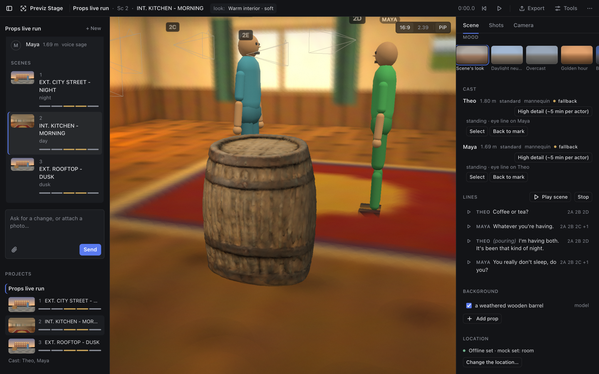

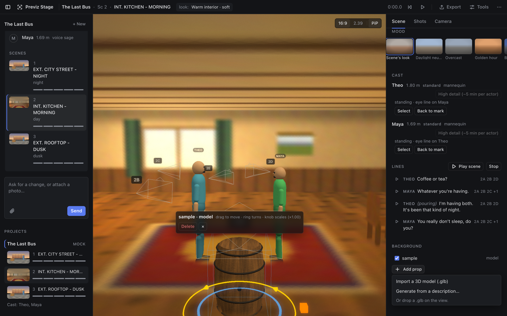

Limits: TripoSR sees one picture, so the back of the object is a guess. Colours come from the
picture with its studio lighting baked in, and the set lights them again. There is no texture
map, so print and fine detail blur. Thin parts (chair legs, railings) can break up. One object per
description. A job that is running when the server restarts reads back as failed (Retry starts it
again). Re-prompt's region tools edit the splat world, not a model prop.

### Found models: a real model when one is found, the primitive otherwise

A background prop of any procedural kind can carry a found model (`DynamicElement.model`: an
open-licence glTF the server found for its label, with its licence and attribution). The viewer
(`web/src/viewer/found-model.ts`, shared by the laptop and the phone) builds the kind's
primitive first and swaps the model in when it has loaded (one load per URL, at most 15 MB), so
nothing flashes and nothing is missing while it loads.

- **Size and facing.** The model is centred, stood on the ground and scaled to `heightM`, else to
  the primitive it replaces: the height of a walker (creature, dog, horse, pedestrian), the length
  of anything else, so "a huge T. rex" stays huge. A display platform under it is hidden.
  Its front is found from its part names (head, jaw, beak, headlight, front, hood, FL/FR wheels
  against tail, rear, trunk, exhaust), else from its walk clip's own travel, else from its shape:
  an aircraft's length is the axis it is not mirror-symmetric across (a wingspan is often longer
  than the fuselage) and the propeller marks its nose (else the fin its tail). Anything else faces
  +Z (glTF's convention) when it is long along Z, and −X when it is long along X. This was checked
  on 20 Objaverse models: every named one was right, and three of the four unnamed X-long cars
  faced −X. **Turn around** fixes the rest.
- **Animals and characters animate with their own clips.** Clips are chosen by name: idle, stand
  and breath for standing; walk, trot, fly, flap and swim for moving; run, gallop and sprint above
  the walk-to-run speed of the animal's size. Attacks, jumps, deaths, turns and strafes are never
  chosen. An unnamed clip counts as a walk when its leg or wing bones repeat, or when it is a short
  loop. A walk is driven by the distance travelled, and its natural speed comes from its root
  motion (which is then taken out, because the path moves the body) or from cycles × stride ÷
  duration, with a stride of 1.5 / 2.1 / 2.7 hip heights for a walk / trot / run. So the feet keep
  pace with the ground at any path speed: the velociraptor below walks at 1.3 m/s with its clip at
  ×0.93. At the end of the path it cross-fades to idle over 0.3 s. Birds and dragons flap on the
  scene clock and keep the primitive's pitch into climbs and bank into turns.
- **Vehicles, aircraft, boats and saucers move rigidly.** Nodes named wheel or tyre roll with the
  distance, rotor, propeller, prop and fan spin, a turret sways. Their own clips (a propeller loop)
  play on the scene clock. Aircraft pitch and bank. Hovering craft bob, and a flying saucer turns
  slowly.
- **Fallback.** A creature-like kind (creature, dog, horse, pedestrian, bird, dragon, and bicycle
  or wagon, whose riders and horses the primitive draws) without a clip for what it does keeps its
  primitive: a gliding statue is worse than a low-poly walker. So does any prop whose model is
  missing, fails to load or is over budget.
- **Credit and control.** Scene › Background and Tools › Objects show, under each such prop, its
  licence and attribution (or why its model is not used). **Use primitive** / **Use found model**
  and **Turn around** apply live and are remembered per scene in this browser. The phone draws the
  server's choice until these become a scene edit.

**Measured** (2026-10-25, GPU Chromium, 1440×900, MOCK field set, six found models in view:
velociraptor 8.4 MB, race car, Cessna 4.0 MB, UFO, seagull, plus the clip-less allosaurus): each
model, loaded alone from the local server, was ready 5–51 ms after its prop was created (fetch,
decode and analysis). Uncapped, the laptop rendered 649 fps with the found models against 673
with their primitives (1.54 against 1.49 ms per frame). With vsync both run at 60.

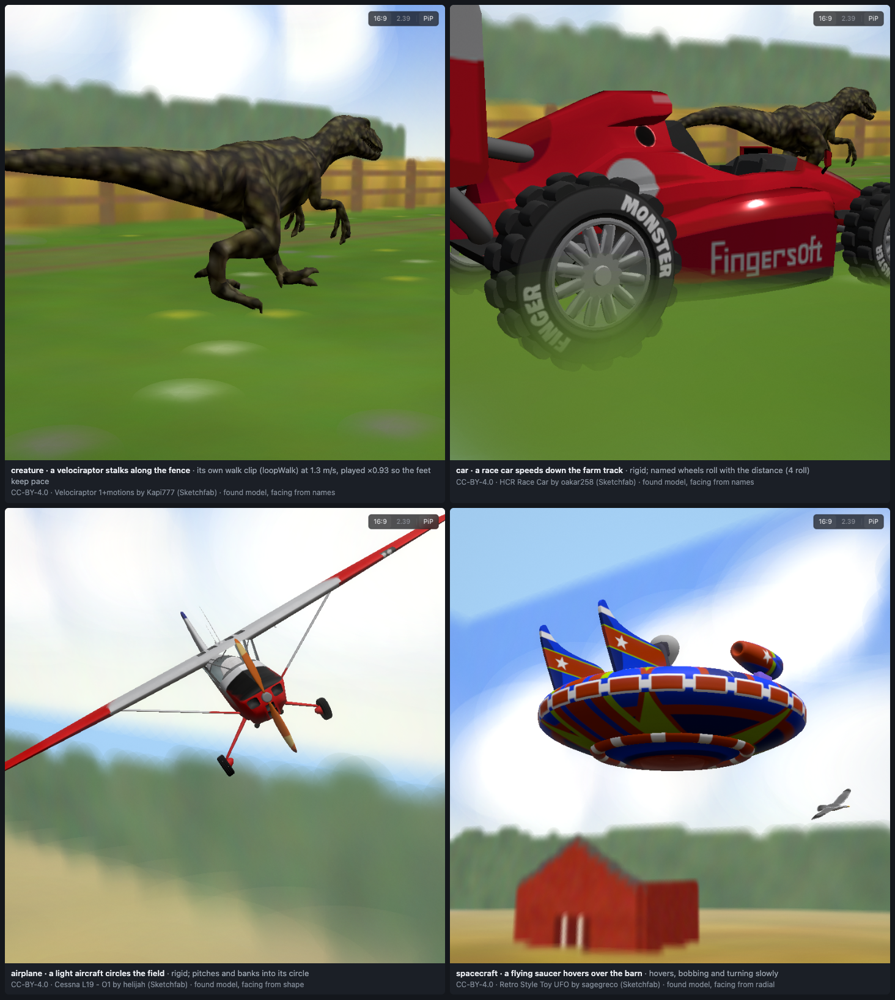

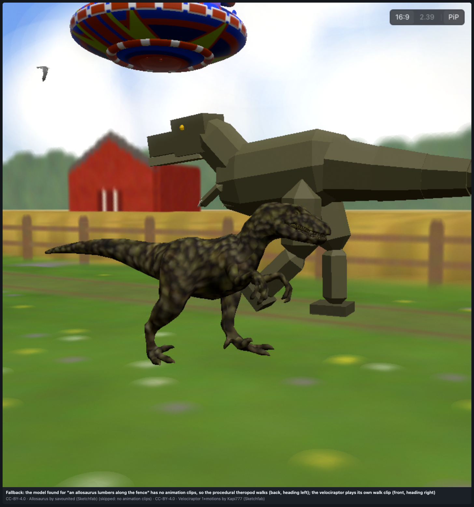

`docs/images/found-models-scene.png` is the whole laptop, with the Background list showing each
prop's licence. The test models are CC-BY-4.0 Sketchfab models from Objaverse, credited in the
captions. Dev page: `/src/viewer/dev/found-models.html?cells=<json>` shows found models next to
their primitives, with the facing used and the clip playing.

## Laptop layout and direct manipulation

The director page has the script drawer on the left (the project chat above every project and its
scenes; the top bar's drawer button or `[` collapses it), the viewport, and the right panel's three
modes, in the order of the work (Tab steps through them):

- **Scene**: the heading with interior / exterior and time of day, the project's scenes as a
  strip (`Sc 1`, `Sc 2`), **Mood** (the eighteen full-look presets as named swatches you can scroll,
  the planner's choice marked with a dot, **Scene's look** first; a click applies the preset and
  keeps the lights and lens, as the preset list in Tools › Grade does), **Cast** (photo, name,
  height, pose, eye line, the staged mark's note, Select and Back to mark, High detail), **Lines**
  (click to play one in place, Play scene runs them in order with the background action; the shot
  numbers that cover each line), **Background** (the moving props, each with on / off, a
  `prop-remove` edit the phone follows) and **Location** (the world in one line; **Change the
  location…** opens the chat on this scene with the composer focused and `Scene 1: ` typed, and a
  photo attached next is aimed at the scene).
- **Shots**: the shot list (below).
- **Camera**: the phone (QR, status, the shot it is on, Re-center, View through the phone, new
  room), Record take and Save frame, the scene clock, and this session's **Takes** (name with the
  shot the phone was on, duration, a player, download; each take also downloads as WebM when it
  stops).

The top bar reads `brand · Project · Sc 1 · HEADING · look: <name> … clock ⏮ ▶ · Export · Tools · ⋯`.
**Reset** (⏮, `0`; Camera › Scene clock has the same button) puts the scene back at its top: a
take being recorded stops (it is kept), the clock pauses at 0:00, the dialogue and its captions
stop, walk-ins and the background props go back to where they start, everyone stands on their
current mark (your moves stay), and the view flies to the scene's start view; the look, shots,
edits and takes stay as they are, and the phone follows the clock (`docs/images/reset-scene.png`).
**Tools** (`T`, or the button) opens a drawer over the right panel with collapsible sections:
**Grade** (the Look panel: grade, LUT, film, atmosphere, lens / depth of field, lights, presets,
compare), **Re-prompt** (describe a change in words, regions, history), **Objects** (the outliner
of props, lights and shots) and **Developer** (splat quality, Grid, Collider, Reload, the world's
scale / floor / ground field / collider details and which API keys the server has). Nothing moved
out changed its behaviour. The viewport's segmented control keeps the frame guide's aspect
(16:9 / 2.39) and PiP. A three-step tour (fly → add a shot → pair the phone) shows once on first
run; the cheatsheet (`?`) can replay it. Every button has a hover hint. The UI never shows a field
of view in degrees (lenses are in mm), and splats, the collider and revisions only appear under
Tools › Developer.

**Shots.** Each scene's shot list is numbered as a filmmaker writes it (scene 1, third shot: `1C`)
and stored in `scene-<n>/shots.json` (`shared/shots.ts`; 300 ms after the last change, a
revision-checked PUT; on a 409 the stored list comes back and the changes not yet stored are
replayed onto it). A row shows the number, the frame grab, the name and note (both editable in
place), the lens (`35 mm`, the nearest prime to the stored vertical field of view, full-frame
equivalent: f = 12 / tan(vfov / 2)), the camera height above the ground, a dot for coverage
(hollow) or your own shot (filled) and a phone mark on the shot the phone is on; hover shows move
up / down, duplicate and delete (drag the grip to reorder). The selected shot opens a lens picker
(18 … 135 mm), Re-grab frame and the lines it covers (toggles).

- The first time a scene without a shot list opens, it is seeded with suggested coverage (Wide
  master, Two-shot, Over X's shoulder on Y, a Close-up per actor) framed on the actors where they
  stand once the scene has settled (`web/src/viewer/shots.ts`: after staging, drags and chat
  moves), each covering the lines of the actor it is on (wides cover every line). **Refresh
  coverage** frames them again (the director's shots stay, and a suggested shot you rename, re-lens
  or move becomes yours); the panel says so when the cast has moved since. A scene whose start
  camera is the server default opens on the Wide master.
- **Selecting** a shot (click, or `1`–`9`) flies the view there and puts the phone on it: the
  shot list is the phone's camera list (`SceneState.cameras`, one `DropCamera` per shot with the
  same id, named `1B · Two-shot`, `activeCameraId` = the selected shot). While selected, a frame
  guide (16:9, or 2.39 from the segmented control) mattes the view and a label reads
  `1B · Two-shot · 35 mm`; the viewport camera opens just wide enough that the guide is exactly the
  shot's frame. Moving or zooming the view leaves the shot (guide and label go; the phone stays).
- **C** adds the current view as the next shot (`Shot 1F` until renamed; the guide's crop of the
  view, so the frame is what you saw) and grabs its frame; **F** grabs the selected shot's frame
  again. A frame is the guide's part of the next rendered frame without the gizmos, ≤ 960 px wide,
  JPEG ≤ 600 KB, uploaded to `PUT …/shots/:shotId/frame`. Shots without a frame get one when the
  Shots mode first shows them (the view visits each and comes back; a key or click stops it), from
  **Grab N frames**, or before an export.
- Dragging a shot's frustum in the viewport moves the shot, ⌫ deletes it and ⌘Z brings it back
  with its frame and note (the panel's delete goes through the same undo).

**Export** (top bar) has **Storyboard (PNG)** — the project title, the scene heading, then the
scene's frames three to a row, each with its number, name, lens, height, note and the lines it
covers (or —), composed on a 2400 px canvas and saved as `<title>-sc<n>-storyboard.png` —,
**Storyboard (print / PDF)** — the same sheet as a print page in a new window (A4 landscape, rows
kept whole) that opens the print dialog — and **Shot list (CSV)** (`GET
/api/projects/:id/shotlist.csv`, every scene).

**Design.** The laptop and the phone share one small design system (the `:root` tokens of
`web/src/laptop/style.css`, repeated at the top of `web/phone.html`). A near-black canvas
(`--bg`) and two lighter surfaces (`--surface-1` for panels, `--surface-2` for inputs, menus and
the current row); text at two levels (`--text`, `--muted`); hairlines (8 % white) only where a
boundary is needed; one accent (`--accent`) for the single filled primary action of a panel and
for active states (the tab underline, the chat's project, a speaking line). Status colours
(`--ok`, `--warn`, `--bad`) are desaturated and only ever a 6 px dot or plain text. One radius
(6 px), an 8-pt spacing scale (`--s1`…`--s6`), one type family (`-apple-system, system-ui,
Inter`) at 13 px body, 12 px secondary, 11 px uppercase section labels (0.06 em tracking) and
20 px for the one title, weights 400 / 500 / 600, tabular numerals for clocks and values; the
screenplay box and plan diffs keep a monospace. Sections are a label and space, not boxes;
buttons are ghosts (a hairline ring) except that one primary; tabs are text with an underline;
the viewport's frame guide and PiP toggles are one low-contrast segmented control; a scene's
pipeline is a five-segment bar; chat actions are a thin left rule and plain text. Icons are
16 px inline SVG with 1.5 px strokes (`web/src/laptop/icons.ts`; `index.html` asks for one with
`<span data-icon>`), no icon font or CDN. Empty, loading and error states are one muted, centred
sentence. The catalogue new UI is built from (section labels, ghost / primary / icon buttons,
fields, text tabs, the segmented control, list rows and 16:9 thumbs, tags, status dots, the
segmented progress bar, ruled blocks, menus, dialogs, toasts, viewport labels) heads `style.css`.

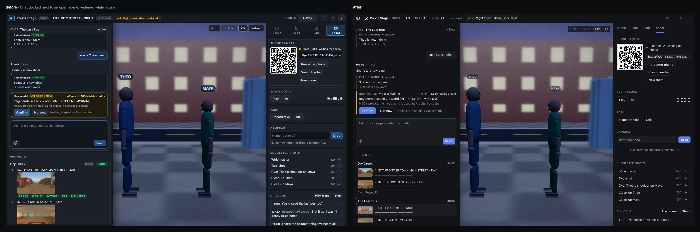

More before / after of the design pass (on the earlier four-tab layout): [empty
chat](docs/images/ui-chat-empty-before-after.png), [Scene](docs/images/ui-scene-before-after.png),
[Look](docs/images/ui-look-before-after.png), [Edit](docs/images/ui-edit-before-after.png),
[Shoot](docs/images/ui-shoot-before-after.png), [phone](docs/images/ui-phone-before-after.png).

Everything in the viewport can be grabbed (`web/src/viewer/manipulate/`):

- **Hover** outlines an actor, prop, light or shot (its frustum, labelled with its number);
  **click** selects it: a ring on the floor, a yellow rotate ring, an orange knob (a prop's scale,
  a light's radius), a green focus point on a shot's view axis when depth of field is on, and a
  small toolbar over it (Reset to blocking, Delete, Phone here, Go to shot).
- **Drag** moves it on a floor-parallel plane through the point you grabbed, so it stays under
  the cursor; **Shift+drag** raises / lowers; the ring turns (Shift snaps to 15°); arrow keys nudge
  5 cm (Shift 50 cm) along the world axis the view faces most. Actors cannot be dragged into walls:
  the collider's body probe (the same test that fixes LLM blocking at load) stops them at the last
  free spot. **Delete** removes props, lights and shots; actors are reset to their blocking
  instead. **Esc** deselects. Left-drag on empty space looks around (as does right-drag), so the
  fly controls and the manipulator never fight.
- **Click the set** (nothing under the cursor) to select a region of it: a sphere at the hit
  with an auto radius from the splats around it (Re-prompt's selection code), resized by
  dragging its outline. Its toolbar recolours the region (luminance-keeping hue), hides it, moves
  its splats (Move, then drag inside), hands it to Tools › Re-prompt as the selection for a prompt
  (`director.pendingRegion`), or deletes the region's edit. Clicking an object already edited
  selects that edit again.
- Where changes go: actors and props become `transform` / `prop-remove` scene edits and regions
  `splat-region` edits in `edits.json` (one director edit per target, kept last so it wins; live
  while dragging, saved on release), which the viewer's edit applier renders on the laptop and the
  phone; lights and focus go into the look; shots go into the shot list, and a phone attached to
  a dragged shot follows it live (≤ 20 Hz). Every change is one undo step: ⌘Z / ⇧⌘Z undo / redo
  whichever changed last, the director's stack or Tools › Grade's own history.

Earlier layout (four tabs): [Scene](docs/images/ux-scene.png).

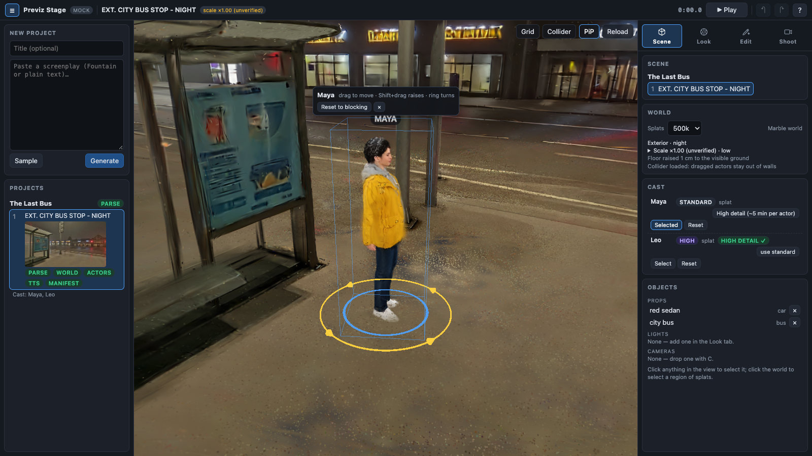

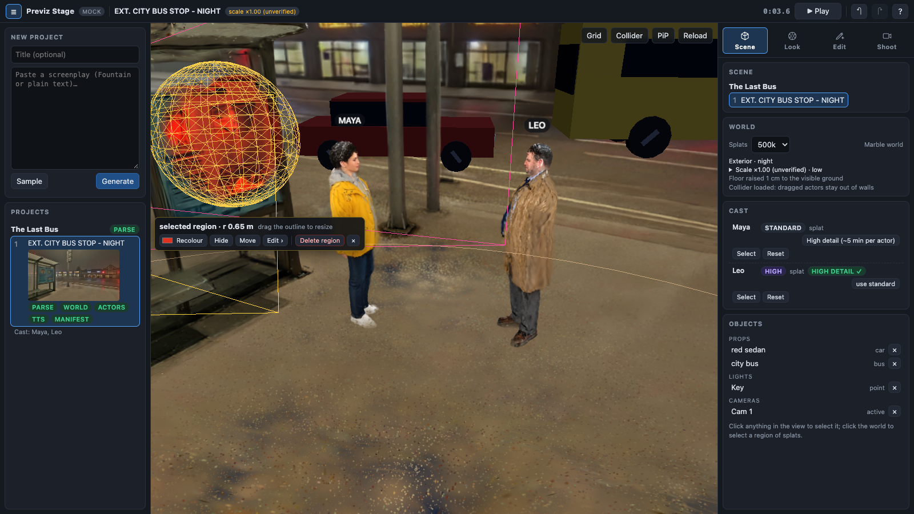

More (earlier layout): [Look tab](docs/images/ux-look.png), [Edit tab](docs/images/ux-edit.png),
[Shoot tab](docs/images/ux-shoot.png), [region selected](docs/images/ux-region.png),
[cheatsheet](docs/images/ux-cheatsheet.png), [first-run tour](docs/images/ux-tour.png).

## Re-prompting (Tools › Re-prompt): change only what the prompt touches

Type a change in **Tools › Re-prompt** ("make the pillow on the left red", "move Leo a metre closer to
Maya", "warmer and more contrast", "make the sky stormy") and press **Send**. The current view
(a ≤ 300 KB JPEG plus its camera) goes with the prompt, so "left" and "right" mean what you see.
The server asks Claude for an **EditPlan**: a scope and typed ops (`shared/look.ts`). The scope
decides the cost, and the planner must pick the cheapest one that does the job:

| Scope | Examples | Cost | What happens |
| --- | --- | --- | --- |
| `look` | warmer, more contrast, night mood, add a key light from the left | instant | a Look patch, baked into the scene look (Tools › Grade keeps editing it) |
| `transform` | move Leo closer, rotate the bench, make the car bigger | instant | actor / prop transform edit; a moved light is a look patch |
| `prop` | add a bicycle leaning on the shelter, add a dinosaur walking by, remove the bus | instant | procedural prop added (drag it to place) or removed |
| `splat-region` | pillow red, remove the lamp, make the plant taller, shift the chair left | instant, no re-render | a Spark `SplatEdit` region on the world splats only: recolour, hide, move, grow / shrink |
| `world-regen` | stormy sky, make it winter, turn the kitchen into a diner | ~5 min + 1,580 Marble credits, **asks first** | a confirm card; on **Regenerate** the world's own panorama is edited by an image model (sky-only edits keep the ground pixel-identical) and fed to Marble as an image prompt, or the text prompt is re-run; actors, look and props are kept, region edits dropped with a note |
| `clarify` | "the thing on the left" | free | the planner asks which object you mean |

A region op needs a 3D target and is never guessed: the planner uses the region you selected in
the viewport (click the set, or **Select** in Re-prompt; Shift+drag for a box), else Claude
vision boxes the named object in the view you sent (`needsTarget[].box`), which is raycast into a
3D region and previewed before **Apply**; if neither works a banner asks you to click the object.
Every applied edit lands in `scene-<n>/edits.json` with the prompt that produced it and shows in
the panel's history, where each one can be switched off (a look op restores the values it
replaced), deleted or undone (**Undo last**). The response always says what changed and what did
not. Under `MOCK=1` or without an Anthropic key a keyword planner follows the same rules offline.

Routes: `POST /api/projects/:id/scenes/:n/reprompt` (`{ prompt, selection?, view? }` → `{ plan,
edits }`; cheap scopes are applied and saved, regen and clarify come back unapplied) and
`POST …/regen` (`{ plan.regen }`, runs the world stage again; `MARBLE_DRY_RUN=1` logs the Marble
requests instead of sending them, which is how the regen path was verified).

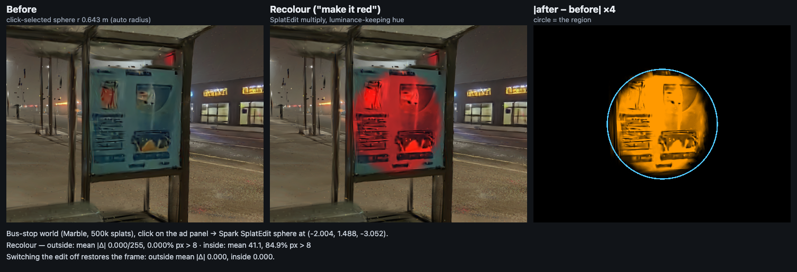

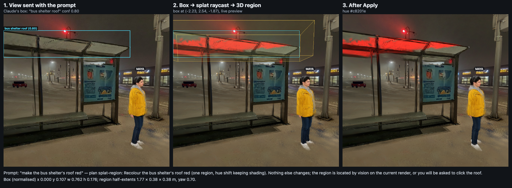

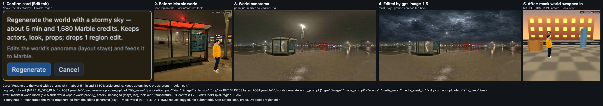

More: [hide + move a region](docs/images/reprompt-region-hide-move.png), [phone parity of a region
edit](docs/images/reprompt-phone-parity.png), [the snow caveat](docs/images/reprompt-regen-snow-caveat.png).

## Pair the phone

1. Phone and laptop on the same Wi-Fi. The laptop's **Camera** mode shows a room code, a QR code and
   the phone URL (`https://<laptop LAN IP>:5173/phone.html?room=ABCD`); the terminal prints the
   LAN address too. If the panel shows `localhost`, edit the URL to the LAN address.
2. **iOS:** motion sensors need a secure (HTTPS) page. Tap through Safari's certificate warning
   once ("Show Details → visit this website"). To avoid the warning, open
   `https://<LAN IP>:5173/cert.pem` first and install the downloaded profile (Settings → General →
   VPN & Device Management); if it is listed under Settings → General → About → Certificate Trust
   Settings, enable full trust there. A certificate from `mkcert` dropped into `certs/` (without
   `meta.json`) is used as-is and is the most reliable option. The certificate is regenerated
   when the laptop's LAN IP changes, so accept it again after switching networks.
3. Scan the QR (or open the URL), check the room code and tap **Tap to start**. Allow motion
   access when asked and hold the phone in landscape. Without sensors (or if access is denied)
   the phone falls back to drag-to-look.
4. The laptop now shows a pink phone frustum and a PHONE picture-in-picture. The phone is attached
   to the shot selected in the Shots mode (or the scene's start view); **Re-center** maps the phone's
   current heading onto that camera's heading.
5. On the phone, the camera button (right edge, under Record) opens the scene's shot list: pick a
   shot to go there (the laptop's Shots mode selects it too), **Handheld (free)** to leave the shot
   where you stand, or **Add shot from here** to put what the phone sees on the laptop's shot list as
   the next shot (frame grabbed, saved with the project) and stay on it.

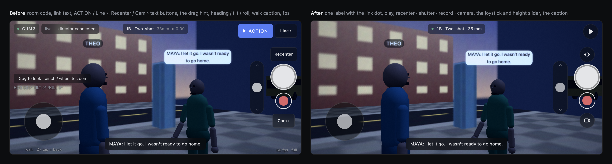

| | |
| --- | --- |
| 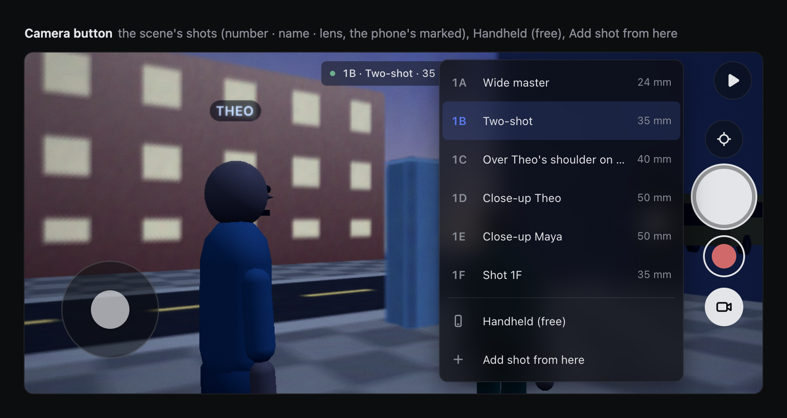 | 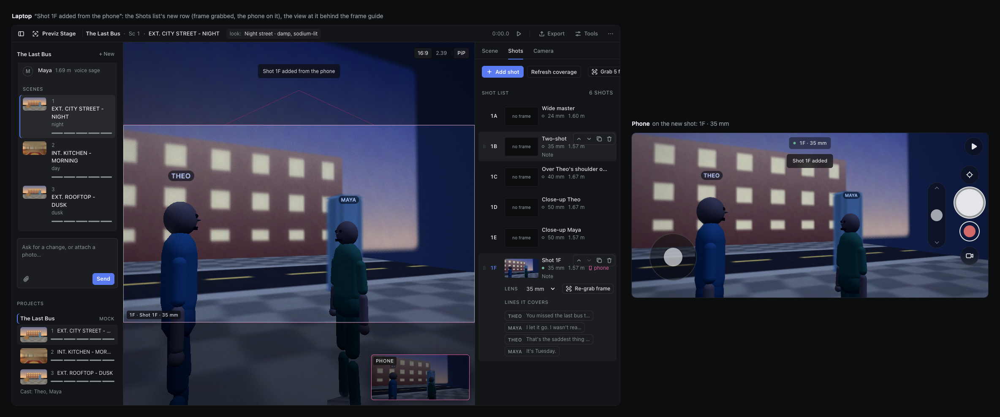 |

## ARKit camera (prototype)

`ios/` holds a native iPhone app (SwiftUI + ARKit, generated with XcodeGen) that joins the same
room as a phone with true 6DoF tracking. Walking moves the camera 1:1 (`PhonePose.offset`,
`source: 'arkit'`), and the shot renders through `phone.html?pose=external` in a web view. It needs
Xcode to build; `cd ios/PrevizCore && swift test` runs its pose and protocol tests without Xcode.
Setup, certificate pairing, the pose math and the web contract are in `ios/README.md`.

**Scan room** (in the app) maps the real room you are filming in: walk it while pointing at the
floor, then tap Done. The laptop draws the room as a dashed cyan box (`REAL ROOM 12.4 m²`) around
the phone's attached camera, exactly where the phone walks, so you can block actors inside the
space you actually have; move or rotate that drop camera to place the room in the world. The phone
outlines its view in red with `Wall 0.3 m` before you walk into a real wall, and says when you are
outside the scanned room. The outline is the convex hull of the floor ARKit found (an L-shaped
room comes out as its hull).

### My room becomes the set

The same scan can become the scene's world. While **Scan room** runs, the app also records the
camera feed (≤ 30 s, 30 fps, ~8 Mbit/s, so well under Marble's 100 MB video limit) and remembers
where the camera stood at the first frame. On **Done** it uploads the video and the scan to the
open scene (`PUT /api/projects/:id/scenes/:n/room-capture[/video]`; free, so the phone may do
it). The laptop's project panel then shows **Scanned room: 12.4 m², 22 s video** under the scene
with **Build set from scanned room**, which spends Marble credits and so only works on the laptop
(`POST …/room-world`, ~5 min). `server/pipeline/room-world.ts` sends the video as a Marble video
prompt and places the result over the real room:

- Marble does not document a video world's frame; like an image prompt's world, its origin is
  taken to be the first frame's camera, looking down −Z.
- **Scale:** the phone's height above the LiDAR floor at the first frame ÷ the world camera's
  height above its splat ground (`calibrate-ground.ts`); outside ×0.4–2.5 Marble's scale is kept
  and marked unscaled.
- **Floor:** that splat ground is y = 0. **Placement:** `WorldAsset.roomAlign` turns the world by
  the first frame's heading and shifts it to where the phone stood, so the scene frame is the scan's
  own walking frame; the world's `startCamera` is the scan's Recentre point at standing height.
- The app keeps the scan's Recentre map; in a scene built from its scan it restores that map
  instead of re-centring (Recentre does the same), so walking moves you through the generated room
  1:1 with the real one. This needs the same app session as the scan (ARKit's world resets when
  the app restarts; re-centre by hand then).

The previous world is kept as `scene-<n>/world.prev-<k>/`; actors keep their planned marks, which
may fall outside a small room (drag them, or "move Leo closer").

## Controls

**Laptop**

| Input | Action |
| --- | --- |
| W A S D, Q / E, Shift | fly, down / up, faster |
| drag empty space, right-drag, or double-click for mouselook | look |
| click / drag an actor, prop, light or shot | select / move it (Shift+drag: up / down; yellow ring: turn; orange knob: scale / radius; green point: focus) |
| ← ↑ → ↓ (Shift), ⌫ / Delete, Esc | nudge 5 cm (50 cm); delete a prop / light / shot; deselect (and close Tools) |
| click the set | select a region of it: **Recolour**, **Hide**, **Move**, **Edit ›**, **Delete region** |
| ⌘Z / ⇧⌘Z, or the top bar's ⋯ menu | undo / redo a move, delete or region edit (or a look change when Tools › Grade changed last) |
| Tab / Shift+Tab | next / previous mode (Scene, Shots, Camera) |
| 1–9 | go to shot 1A … 1I (flies there; the phone attaches) |
| C, or **Add shot** | add the current view as a shot and grab its frame |
| F, or **Re-grab frame** | grab the selected shot's frame again |
| T, or **Tools** | the Tools drawer (Grade, Re-prompt, Objects, Developer) |
| `?`, `[` | keyboard and mouse cheatsheet; script drawer |
| wheel | zoom (changes the lens; leaves the selected shot) |
| Space | play / pause the scene clock (moving props, dialogue sync) |
| 0, or the top bar's **Reset** (left of Play) | reset the scene: clock to 0:00 and paused, dialogue stopped, everyone back on their marks, props at their path start, the start view (shots, edits, look and takes stay) |
| V, or **View** | view through the phone (the PiP then shows the director view) |
| R, or **Record take** | record the canvas plus dialogue audio as a take (WebM) |
| G, Tools › Developer › **Grid** / **Collider** | ground grid at y = 0, collider wireframe |
| click a dialogue line / **Play scene** | speak one line / the whole scene in order (caption + positional audio) |
| **Re-center**, **Save frame**, new room | phone heading reset, PNG from the phone camera, new pairing code |
| Mood swatch, Tools › Grade, Alt+click, hold **Compare** | try a look; grade / lens / lights; focus on what is under the cursor; ungraded frame |
| **16:9** / **2.39** (viewport) | the frame guide's aspect (and of the frames grabbed from now on) |
| **Export** | storyboard PNG, storyboard print page (PDF), shot list CSV |

**Phone**

| Input | Action |
| --- | --- |
| move / turn the phone | frame the shot: pan, tilt, roll, plus handheld sway |
| joystick (bottom left, left thumb) | walk forward / back / sideways along the camera's heading, up to 1.5 m/s |
| double-tap the joystick | back to the attached shot |
| height slider (right) | raise / lower the camera (±2 m) |
| pinch (wheel in `?sim=1`) | lens |
| **camera button** (right edge, bottom) | the shot list as a popover: a shot (number, name, lens; yours marked), **Handheld (free)**, **Add shot from here** |
| swipe the label sideways | next / previous shot |
| **play** (top right) | play the scene on the laptop (dialogue in order + clock) / stop it; hold it for the next line |
| recenter (crosshair, above the shutter) | the phone's heading → the attached shot's heading (keeps where you walked) |
| **Shutter**, **Record** | laptop frame (PNG), laptop take |
| `?sim=1`: drag, W A S D / arrows, Q / E | look, walk, height |

The frame keeps one quiet label at the top, the shot's number, name and lens (`1B · Two-shot · 35
mm`, or `Handheld · 35 mm` off a shot), with a dot for the link (green: the laptop is there; amber:
connecting or waiting for it; red: cut off; a toast says when it changes), the red time badge
while recording, and the line being spoken. The room code stays on the start screen, the drag /
pinch hint shows once, and the render rate only with `?perf=1`. The actors speak on the phone as
well (positional, from the phone camera); "Tap to start" unlocks audio on iOS, and `?voice=0`
mutes the phone if the laptop's speakers are in the room. Details and debug hooks:
`web/src/phone/README.md`.

## Real Marble generation

Marble is the slow and costly stage: about 5 minutes and 1,580 credits (≈ $1.26) per scene with
`marble-1.1`, 230 credits with `marble-1.0-draft`. Every job writes `marble-receipt.json` before
and after the POST, so a crash or a retry polls or downloads the recorded job instead of paying
for a second one.

- From the UI: run the server with `MOCK=0` and `WLT_API_KEY` set, then **Generate**.
- One world from the CLI, straight into the world library so every later project reuses it:

  ```sh
  pnpm tsx server/pipeline/cli.ts generate-world "<environment prompt, no people>" data/marble/city-street-night
  ```

- `MARBLE_DRY_RUN=1` runs the whole live pipeline but logs (and writes to
  `scene-<n>/world/marble-dry-run.json`) the exact request instead of submitting it.
- `pnpm tsx server/pipeline/cli.ts parse <file>` prints Claude's plan (about $0.10 per call:
  ~4.2k input / ~4.4k output tokens on `claude-opus-5-5`); `… cli.ts run <file>` runs a whole
  project from the terminal.

### Reuse instead of re-spending: the two libraries

Live (non-MOCK) projects check two gitignored folders before calling a paid service:

| Library | Path | Matched by | Saves |
| --- | --- | --- | --- |
| worlds | `data/marble/<key>/world-asset.json` (+ files) | scene slug minus `int-` / `ext-` / `int-ext-`: `ext-city-street-night` → `city-street-night` | ≈ $1.26 and ~5 min per scene |
| actors | `data/actors-library/<characterId>/sequence/sequence.json` (+ `frame_000.ply`, `motion.u16`) | character id (`maya`) | ≈ $0.08 and ~3–8 min per character |

A match is copied (APFS clone) into the project, so projects stay self-contained. With both
libraries filled, `MOCK=0` on `fixtures/screenplay.fountain` spends only the Claude plan and TTS
(cents for ~12 lines).

### Scale calibration: is the world really metric?

Marble returns a `metric_scale_factor`, but it can be off by up to 2× on some worlds. After every
Marble download (and from the CLI) the pipeline measures the real scale and stores it as
`WorldAsset.scaleCalibration`. The viewer multiplies Marble's scale by `factor`, keeping the floor at
y = 0, and the laptop HUD shows `scale ×0.87 (door 2.04 m)` next to the scene title (the
calibration's `headline`: the main reference, or `unverified`), with the full evidence in its
tooltip.

```sh
pnpm tsx server/pipeline/cli.ts calibrate data/marble/kitchen-morning            # print the report
pnpm tsx server/pipeline/cli.ts calibrate <worldDir> --write --before-after out.png
#   --no-vision   collider only (free)    --reuse   re-decide the last report, no Claude call
#   CALIBRATE=0 / --no-calibrate skips the pipeline step; CALIBRATE_VISION=0 skips the Claude half
```

The calibration measures with two independent sources (`server/pipeline/calibrate*.ts`) and, when
the collider has no reference, checks them against two weak ones:

- **Collider geometry.** The collider GLB is flattened with the viewer's own transform. Heights are
  measured from the *local* floor, never y = 0: floor to ceiling over open floor, doorways (a
  horizontal-ray sweep for an opening that reaches the floor under a lintel), and flat tops
  classified by shape, never by height (a counter is long and backed by a wall, a table is compact
  with room around it, plus seats and benches). Each one implies `typical / measured`.
- **Claude vision (`claude-opus-5-5`).** Four views from the source camera (0°, ±60°, then behind),
  rendered offscreen in GPU Chromium with 1.70 m mannequins on free, visible floor. Claude names
  standard objects, compares each with the mannequin at the same depth, and marks its floor-contact
  and top pixels. Those pixels are cast into the world (base onto the floor, top onto the vertical
  above it), so heights are perspective-correct. There are two requests on different views, plus a
  close-up request with the mannequin standing beside the best objects found. At least two of the
  three must agree within 15%.
- **Claude's eyeballed comparison** (weak): each run's sizes judged by eye against the mannequins,
  without the pixel geometry. It counts only when the runs agree within 15%.
- **Camera eye height** (weak prior): Marble's text worlds put the source camera at a standing eye
  height, 1.39–1.61 m above the collider floor on three of the four worlds (1.43 m in the kitchen,
  which every reference confirms). The prior is 1.55 m ± 0.2, so a camera 2.17 m up says the world
  is ×0.71 too big, give or take 13%.

With a collider estimate (interiors) the collider decides:

| Collider vs vision | Result |
| --- | --- |
| agree within 10% | apply the collider median, confidence `high` |
| 10–25% apart | apply the collider median (`medium`) only with ≥ 3 consistent collider references |
| more than 25% apart | nothing applied: factor 1, `low`, and the evidence says why |
| collider only | `high` (≥ 3 consistent references) or `medium` |

Outdoors, where Marble's collider never has doors, counters or ceilings, each source is a factor with
an uncertainty σ (log space), and they are combined weighted by 1/σ²:

| Source | σ |
| --- | --- |
| vision | √(0.06² + 0.08²/W + (spread/2)²), W = object weight of the agreeing runs (≈ 12% for four ad panels, 9% for four clean doors or counters) |
| eyeballed | 15% |
| camera | 13% |

| Outdoors | Result |
| --- | --- |
| no vision (runs disagree or found nothing), or weak vision with nothing beside it | nothing applied: the camera alone is only a prior |
| any two sources more than 25% apart | refused: factor 1, `low`, the evidence names the pair |
| combined factor within 1.5σ of ×1 | kept, `low` (HUD `unverified`); the evidence gives ×c ± σ |
| otherwise | apply the combination, `medium` |

Everywhere, a correction under 5% is recorded but not applied, and nothing outside [0.5, 2] is ever
applied. Library copies carry the stored report, and reusing one re-decides it under the current
rule (no Claude call). Cost: 2–3 requests, each about 5k input tokens (two 1280×720 JPEGs) and
1–4k output tokens, so $0.14–0.25 per world. The collider half runs in about 1 s.
`calibrate --reuse` re-decides a stored report for free; with `--before-after` the left panel then
shows the stored decision (old rule) and the right one the new decision.

Results on the four real worlds (heights at Marble's scale; `typ` is the real-world size), re-decided
from the stored reports without a Claude call:

| World | Evidence | Old rule | New rule |
| --- | --- | --- | --- |
| kitchen-morning | ceiling 2.68 m (typ 2.60), doorway 2.09 (2.04), counter 0.95 (0.91), table 0.75 (0.75) → ×0.969, 4/4 consistent; vision runs ×1.04 / ×1.06 / ×0.97 | ×1 (`high`) | ×1 (`high`): sources agree within 6%, correction 3% < 5% (unchanged) |
| rooftop-dusk | parapet tops 1.24–1.46 m (typ 1.05–1.10) → vision ×0.85 ± 13% (runs ×0.75 / ×0.85); camera 2.17 m → ×0.71 ± 13%; eyeballed ×0.59 / ×1.0 (disagree, unused) | ×1, `unverified` | **×0.778 ± 9% applied (`medium`)**, 2.8σ: the parapet comes out 0.97 m |
| city-bus-stop-night (live project) | shelter post / ad panels (tops cut off at the image edge) → vision ×1.16 ± 12%; eyeballed ×0.99; camera 1.61 m → ×0.96; shelter roof 2.73 m (weak) | ×1, `unverified` | ×1, `unverified`: combined ×1.04 ± 8%, 0.6σ, under the 5% deadband |
| city-street-night | bench seat 0.46–0.51 m (typ 0.45) → vision ×0.89 ± 10%; eyeballed ×0.94; camera 1.39 m → ×1.11; awning 3.44 m (weak) | ×1, `unverified` | ×1, `unverified`: vision and camera are 25% apart (refused; the combination, ×0.96, would also have stayed under the deadband) |

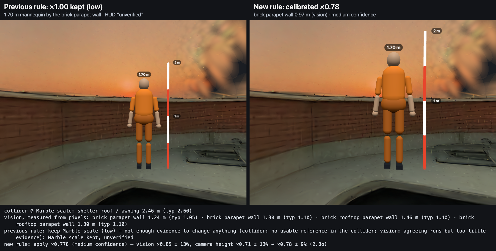

Old rule vs new rule for the other three, with the 1.70 m mannequin standing by the object vision
measured: [bus stop](docs/images/scale-v2-city-bus-stop-night-before-after.png) (the right panel
shows the not-applied ×1.04),
[city street](docs/images/scale-v2-city-street-night-before-after.png),
[kitchen](docs/images/scale-v2-kitchen-morning-before-after.png). The first-rule pictures are still
there: [kitchen](docs/images/scale-kitchen-morning-before-after.png),
[city street](docs/images/scale-city-street-night-before-after.png),
[rooftop](docs/images/scale-rooftop-dusk-before-after.png),
[bus stop](docs/images/scale-city-bus-stop-night-before-after.png).

A scaled world moves everything toward or away from the source camera, so blocking marks written in
metres before calibration can end up inside furniture (×0.78 pulls a bench 3 m out to 2.3 m). The
viewer's collider correction moves such an actor out at load, and the staging step places marks on
the calibrated set.

### Actor heights

Every character has a standing height, `Character.heightMeters` (0.9–2.3 m). The planner takes it
from the script when it gives one ("6'2"" → 1.88, "a boy of ten" ≈ 1.40), otherwise picks a
plausible value for the description (adult women about 1.55–1.75 m, men 1.65–1.90 m, "tall" adds
about 0.1). The MOCK planner gives each character id a stable 1.62–1.85 m (the top of that range
when the intro says "tall": THEO 1.80, MAYA 1.69 in the fixture). Every actor asset carries its
character's height (LHM avatars, library copies, rebuilds and the mannequin fallback; an older
`actor.json` is brought in line), and the viewer scales each body kind so the top of the head is
at that height; the head, label, caption, voice and seated drop follow. The Scene mode's cast row
shows it.

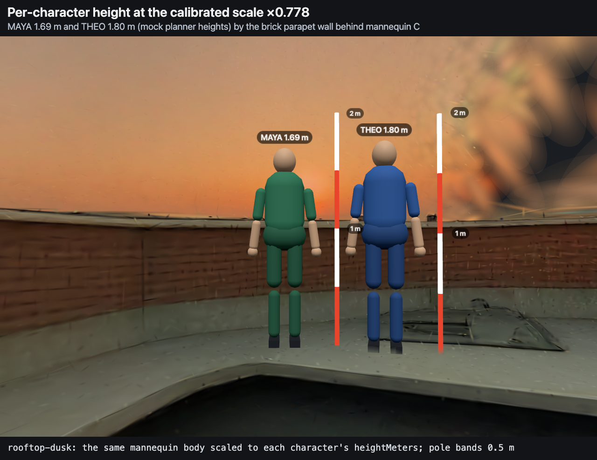

The same pair in the MOCK laptop: [actor-heights-mock-laptop.png](docs/images/actor-heights-mock-laptop.png).

### Floor offset: actors on the visible ground

Marble's declared ground plane matches the splats right under its source camera (within ±2 cm on
all four worlds), but where the actors stand 2.5–3 m out the visible ground can be lower. The same
calibration step measures it from the splats (`calibrate-ground.ts`): at each actor's blocking mark
(or, for a world without a scene, the usual blocking area in front of the camera), it finds the
densest thin layer of opaque splats below knee height. The median is stored as
`WorldAsset.floorOffsetMeters`, and the viewer raises the world by that much (× the scale factor),
collider included, so the ground is at y = 0 where the feet are. The collider is not used for this:
outdoors it sits about 0.1 m below the splats, and raising the world by the collider floor buries
the actors' shoes (middle panel below).

| World | Splat ground (where actors stand) | Collider floor near the camera | floorOffsetMeters |
| --- | --- | --- | --- |
| city-bus-stop-night (`the-last-bus`, at its marks) | MAYA +0.018 m, LEO -0.035 m | -0.124 m | **0.009** |
| city-street-night | -0.058 / -0.038 / -0.161 m | -0.090 m | **0.058** |
| rooftop-dusk | -0.217 / -0.197 / -0.260 m | -0.143 m | **0.217** |
| kitchen-morning | +0.011 / +0.042 m | -0.011 m | **-0.026** |

`calibrate --write` stores it (the splat half is local, about 2 s; `--reuse` re-measures it without
a Claude call). A live project re-measures each scene's world at that scene's marks.

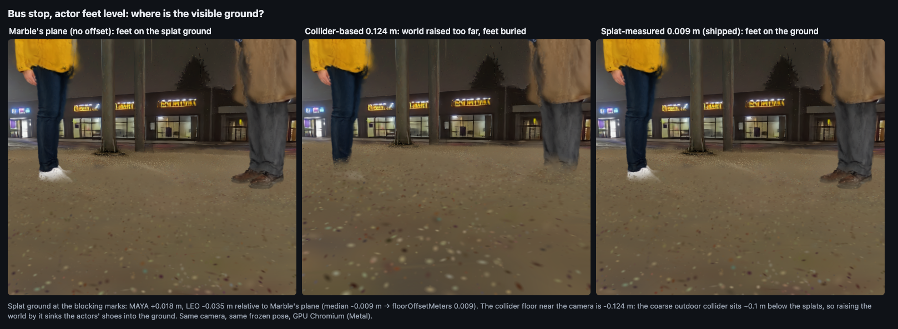

### Ground field: each actor on the ground at its own spot

One median is right only where it was measured. The city street's kerb runs through the blocking
area, the rooftop's walkway sits 0.2 m above its tar deck, and an actor the collider nudges to free
floor lands on a spot nobody measured. So every world also gets a ground height field: `ground.json`
next to the world files, referenced by `WorldAsset.ground` (format and sampler in `shared/ground.ts`).
The viewer stands every actor on it: at load, after the collider nudge, during a drag, under a
re-prompt `transform`, after a High detail body swap, and under a walking body on its way to the
mark. The laptop and the phone share this loader. Actor heights are stored relative to the ground:
a blocking or transform `y` of 0 means "on the ground there", so existing `edits.json` files keep
working.

How a 0.25 m column's ground is chosen (`calibrate-ground.ts`):

- **Flat splats only.** It uses opaque splats lying flat (flat discs within 41° of horizontal).
  92–96 % of floor splats are like that, while walls, cabinet fronts and posts are upright discs.
- **Thin layers.** It takes the column's thin dense layers (2 cm histogram, ≥ 8 splats within
  ±5 cm and at least half of those within ±17 cm).
- **The lowest layer is the ground.** A bench seat, kerb top, table or car bonnet stands on top
  of the ground, so it can't out-vote it.
- **No stepping onto furniture.** A pick more than 0.25 m (one stair step) from its 5×5
  neighbourhood's median is furniture over unseen ground and becomes a hole.
- **Spikes only.** Isolated spikes take their 3×3 median. Nothing is blurred, so a kerb stays a
  one-cell step.
- **The drawn tier decides.** The k500 tier, which the laptop and phone draw, decides every column
  it can. `world_full.spz` (4× denser) fills the rest, shifted by the median tier difference
  (the full tier's ground is 0.5–1.1 cm lower outdoors).

Measuring takes about 0.4 s. It runs in the pipeline for every world (the MOCK floor included), on a
world regeneration, and with `calibrate … --write`. Library copies carry `ground.json`.

| World | Field | With ground | Ground vs Marble's plane | Feet error at the marks, before → after | At the most uneven spots |
| --- | --- | --- | --- | --- | --- |
| bus stop (`the-last-bus`) | 63×60 | 74 % | -0.60…+0.21 m | 2.9 → 0.4 cm | 6.3 → 0.5 cm |
| city-street-night | 64×60 | 90 % | -0.34…+0.23 m | 9.3 → 0.3 cm | 13.6 → 0.2 cm |
| rooftop-dusk (at its ×0.778 scale) | 64×60 | 93 % | -0.33…+0.26 m | 3.1 → 0.2 cm | 18.8 → 0.1 cm |
| kitchen-morning | 24×21 (the room) | 50 % | -0.07…+0.10 m | 3.6 → 1.2 cm | — |

The feet error is the gap between the feet and the k500 splats lying flat within 0.15 m of them,
an independent look at the ground the viewer draws. It is measured in scene metres; the ground
heights are at Marble's scale, so the rooftop's ×0.778 turns its 24 cm walkway step into 19 cm.
For the library worlds the marks are the floor probes. `pnpm tsx scripts/ground-evidence.ts <worldDir> --name <n>` renders the pictures below
(1.70 m mannequins in GPU Chromium; feet close-ups, before | after).

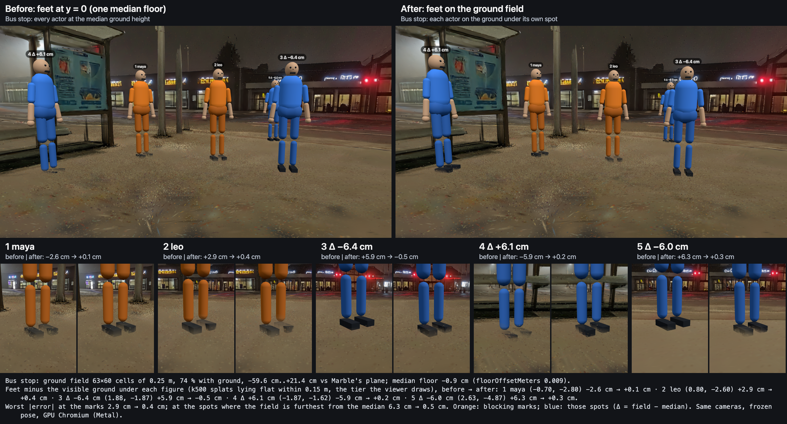

More: [city street](docs/images/ground-city-street-before-after.png),
[rooftop](docs/images/ground-rooftop-before-after.png), and the fields as heat maps:
[bus stop](docs/images/ground-bus-stop-field.png),
[city street](docs/images/ground-city-street-field.png),
[rooftop](docs/images/ground-rooftop-field.png).

To refresh an existing scene's ground offline (no Claude call, no Marble call):
`pnpm tsx server/pipeline/cli.ts calibrate data/projects/<id>/scene-<n>/world --reuse --no-vision --write`.
This writes `ground.json`, `world-asset.json` and the scene's `manifest.json`.

### Real avatars need Modal billing

The LHM stage runs on a Modal L4 GPU. Modal refuses L4 functions until the workspace has a payment
method, and until then every actor falls back to the mannequin (marked `fallback`, so a retry
upgrades it once billing works). Measured: 480 s wall clock for the first avatar including the
download, 162 s of L4 time, about $0.08, 72 frames at 12 fps (49 MB slim). Setup, one-time weight
staging and the worker CLI are in `worker/README.md`. Copy a finished
`<project>/actors/<id>/sequence/` into `data/actors-library/<id>/` to reuse it.

A "High detail" rebuild (LHM-1B + fine-tune, see above) costs about $0.05–0.06 and 3–4 min per
actor (123 s of L4 measured). Each avatar also gets a **runtime rig** (canonical splats + skin weights + SMPL-X skeleton,
2 MB instead of a 40 MB baked track): the browser animates it on the GPU from a shared library of
text-to-motion clips (HY-Motion 1.0, generated once: listening idle, two talking loops, seated
idle/talk, a walk cycle), so actors gesture while they talk, turn their heads to the speaker, sit
and walk to their marks. Older actors get one without re-running LHM:
`python3 worker/run_actor.py --rig data/actors-library/<id>`. Measurements and the before/after
evidence are in `worker/README.md` ("Performance motion").

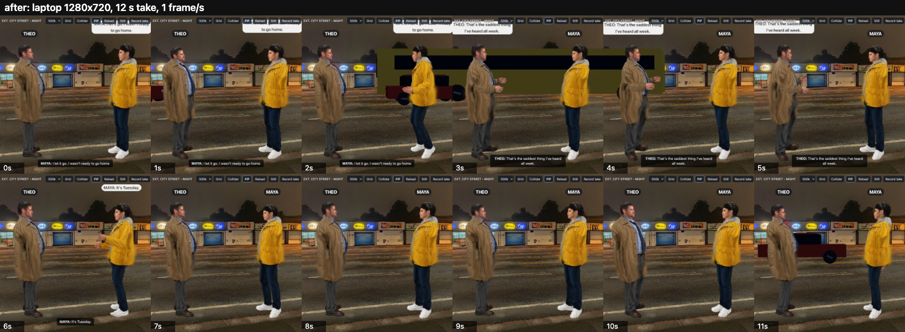

## Tests

```sh
pnpm typecheck                        # tsc --noEmit
npx playwright install chromium       # once, for the e2e browser
pnpm e2e                              # Playwright against a MOCK server on :5390 (temp DATA_DIR)
pnpm check                            # both
npx tsx scripts/actor-browser-check.ts [--sequence data/actors-library/maya --gpu]
npx tsx scripts/compare-shots.ts --base https://localhost:<your port> --col <manifest> --col <manifest> --view x,y,z:tx,ty,tz:fov --out x.png
npx tsx scripts/look-check.ts all --base https://localhost:<your port> --project <id> [--before https://localhost:<pre-look build>] [--docs]
cd worker && python3 -m pytest -q tests
```

There are no unit-test files by choice: the project is evaluated by this e2e run and by rendered
evidence (the screenshots and contact sheets in `docs/images/`). The e2e suite (`tests/e2e/`) creates projects through the API, opens the laptop, and pairs a
second browser context as the phone (`/phone.html?sim=1`, synthetic `deviceorientation`). It
checks that manifests validate and every asset is served, the splat world renders with real
colour, props move, a clicked line shows a caption and plays WebAudio, the phone's pose turns the
laptop's frustum gizmo and feeds the PiP, the phone captions the line the laptop plays, recenter /
shutter cross the relay both ways, the phone's camera popover puts it on another shot and adds its
view as a new shot on the laptop's list, the phone renders WebGL on its own, the
certificate / health / room endpoints work, and the fantasy fixture comes out as a fantasy: its
style, a look per scene, the forest and hall sets, a seeded edits.json, a dragon, and a laptop
frame that opens graded (about 10 % mean difference from the same frame with a neutral look), and
a scene's shot list is seeded with coverage the first time it opens, C adds the view as a shot whose
frame is stored as a JPEG, the list comes back after a reload and the CSV export lists every shot
(`shots.spec.ts`), and a dinosaur lumbering past and an airplane flying low overhead come out as a
creature and an airplane that move on the clock with their own bodies, then the chat's hovering
helicopter reaches the open scene without a reload (`dynamics.spec.ts`). A .glb imported through Add prop and a prop generated from "a barrel" (the
MOCK sample) both land in edits.json, undo and redo, and load on the phone (`props.spec.ts`). Headless Chromium has no GPU: SwiftShader draws the
33k-splat mock world at about 1 fps at 1280x720 once it is fully loaded (the e2e specs are written
for that). A real Marble world (500k splats) needs a GPU; full Chromium with
`--use-angle=metal --enable-gpu` renders it at 60 fps.

Debug hooks: `window.__previz.state()` on the laptop and `window.__phone` on the phone
(see `web/src/phone/README.md` for the phone's URL flags such as `?sim=1`, `?3d=0`, `?governor=0`).

## Known limitations

- **No 6DoF tracking.** A browser exposes orientation and acceleration, not position: the phone
  rotates freely around the camera it is attached to and adds a damped ±0.3 m handheld sway;
  moving through the scene is done with the on-screen joystick, not by walking with the phone.
  True 6DoF would need a native ARKit/ARCore companion speaking the same protocol.
- **No visemes.** A rigged LHM avatar opens its jaw with the voice's loudness (the mannequin
  too); there is no phoneme lip-sync. Seated actors sit on nothing (no chair is placed); a long
  coat stretches at the hips when seated. A `walking` actor without beats starts 2.4 m behind its mark and
  walks in when the scene clock runs. Walks (that and beats) go in a straight line and ignore the
  collider; the motion vocabulary is the shared clip library (standing, talking, sitting, walking),
  so without `MOTION_GEN` a beat like "slams the table" is staged by position and facing, not a
  matching gesture. Generated gestures are one take each, not retargeted to props (a hand meant
  for a table stops in the air) and play only on rigged LHM avatars. Avatars built before the
  runtime rig (no `rig` in `sequence.json`) still play their baked idle/talk loop and are lowered
  0.45 m when seated.
- **iOS is untested headless.** The automated tests drive desktop Chromium with synthetic sensor
  events; the iOS Safari permission and certificate flow was only exercised by hand.
- Blocking is written by an LLM without seeing the world. When a collider is available, actors
  standing inside geometry or off the floor are moved to the nearest free floor (within 3 m),
  which is approximate in very tight interiors.
- Scale is verified only where the world has standard objects near the camera. Interiors
  (counters, doors, ceilings) measure well. The three outdoor worlds have coarse colliders and few
  doors or benches in reach, so they stay at Marble's scale marked `low` / unverified.
- The ground field is a 0.25 m grid. On the line of a kerb the bilinear sampler blends the two
  heights over one cell, so a foot right on the edge can be a few centimetres off. Columns with too
  few flat splats (under benches and parked objects, far edges) are holes. There the nearest ground
  within 0.5 m is used, else the median floor. Worlds calibrated before the field existed stand on
  the median floor until `calibrate … --write` (or a world retry) measures one.
- High-detail actors carry front-view texture: seen from far to the side (≳60° off the reference
  view) the face and trousers show pale streaks. The back is unchanged.
- Moving props are simple procedural shapes on straight looped paths, composited over the splats.
- Genres: **Scene's look** is offered only when the scene's manifest carries `plan.look`. A plan
  made before looks (the live bus stop) still opens with its derived look, written by the manifest
  stage or `cli look --write`, but the button stays hidden until the manifest is rewritten. Mood
  words name what the action says, not what the grade does: the bus stop's "Night street · damp,
  sodium-lit" cools the sodium-orange street toward blue. Ten mock sets cover every heading, so one
  `village` (timber storefronts) serves a western main street and a Viennese palace courtyard, and
  one `hall` (throne, banners) serves a throne hall and a ballroom.
- Takes record the laptop canvas (WebM), not the phone's own render.
- Look lights recolour baked splats; they cast no new shadows and do not reveal what the capture
  never saw. Only four lights reach the splats. Fog and sky tint are applied per splat, so the
  sky mask is a rule (far, and above the horizon as seen from the camera) rather than a
  segmentation: tall buildings far away can pick up some of the sky tint.
- A shot's own depth of field is stored in the laptop's browser storage (the shot itself, with its
  lens in mm, is in `shots.json`). It is not in `edits.json`, so another laptop opening the
  project does not see it. The viewport's focus point edits whichever lens the shot renders with
  (its own, else the scene's).
- Direct manipulation: only actors are kept out of walls (props, lights and cameras move freely);
  actor and prop moves apply once the collider has settled the blocking (a second or two after a
  real world loads; the toolbar says so if you grab earlier); a prop driving along its path is
  moved by shifting its whole path and cannot be turned. Shots and lights are not scene edits
  (shots live in `shots.json`, lights in the look), so Re-prompt's history does not list their
  moves; the undo stack does.
- Re-prompting: a **season or weather regen that touches the ground does not keep the layout**:
  when the whole panorama is editable, the image model draws a new street rather than editing the
  360° image in place, so a real Marble regen from it would be a different-looking place. Sky-only
  edits are safe (the original ground is composited back). Region edits: Spark has no hue blend,
  so "hue" is a luminance-keeping multiply (strongly coloured surfaces of another hue go darker
  instead of changing hue); grow / shrink moves splats on a 5×5×5 displacement grid but cannot
  resize the splats themselves; "move" leaves a hole where the object was. An interrupted regen
  resumes when re-requested, not on server restart. No real regen has been run (credits), only
  dry runs with the request logged.

## Repository map

```
shared/           contracts (schema, protocol, api) + pure helpers shared by server and browser
server/           HTTPS entry, relay, env, pipeline/ (stages, libraries, CLI)
web/src/laptop/   director UI;  web/src/phone/  phone camera;  web/src/viewer/  shared 3D loader
worker/           Modal LHM avatar worker (Python)
ios/              ARKit camera app (prototype): Xcode project, PrevizCore Swift package
fixtures/         sample screenplays (genres/), mock sets (mock-world/<set>/), real-provider samples
tests/            Playwright e2e (tests/e2e)
docs/             PLAN.md and screenshots
```

Shot list storage (`server/pipeline/shots.ts`, contract `shared/shots.ts`): each scene's coverage
is `scene-<n>/shots.json`, read and written like `edits.json` (`GET / PUT
/api/projects/:id/scenes/:n/shots`, defaults while absent, a stale `revision` gets 409 with the
current list). `PUT …/shots/:shotId/frame` takes a raw `image/jpeg` (≤ 600 KB, sniffed as JPEG)
and stores it at `scene-<n>/shots/<shotId>.jpg`, served from `/projects/<id>/…`; it sets the
shot's `frame` + `frameAt` and bumps the revision. Shot ids must be path-safe and unique.
`GET /api/projects/:id/shotlist.csv` downloads every scene's shots (scene, number, name, lens_mm,
height_m, note, lines, frame_url; UTF-8 with a BOM so Excel opens it, formula-like text prefixed
with `'`).
