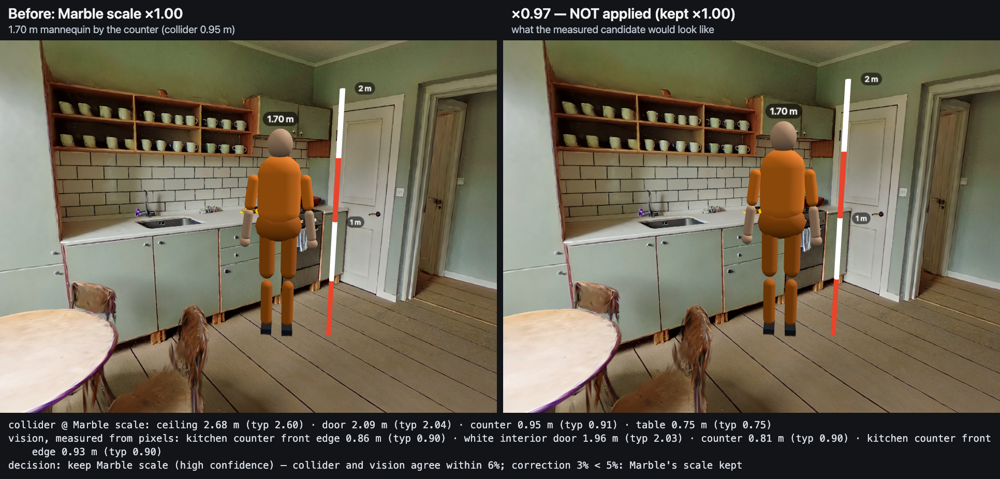

# Previz Stage

Paste a short-film screenplay and get one walkable 3D scene per screenplay scene: a World Labs
Marble gaussian-splat world, the characters standing in it as LHM gaussian avatars (or a tinted
mannequin), their dialogue voiced with TTS, and moving props for the action lines ("a red sedan
drives past"). Fly around the scene on the laptop, drop virtual cameras, then pair a phone in its
browser (no app) and use it as the handheld camera: its orientation sensors pan, tilt and roll
the shot, its accelerometer adds handheld sway, and its frustum and live view appear on the
laptop while the actors speak their lines.


## Architecture

```
 screenplay (.fountain / text)
        │  POST /api/projects
        ▼
 server/pipeline/  ── per project, every stage idempotent and resumable after a restart ─────────┐
   screenplay.ts   Claude (claude-opus-5-5) → ScreenplayPlan: scenes, characters, dialogue,     │
                   blocking, moving props, suggested shots           (offline parser in MOCK)  │
   marble.ts       world prompt → Marble text→world, receipt-first (a crash never pays twice)   │
                   ↳ world-library.ts: reuse data/marble/<slug without INT./EXT.>              │
   actors.ts       description → OpenAI reference image → LHM on Modal L4 (worker/) →          │
                   splat avatar + runtime rig; any failure → procedural mannequin (fallback)   │
                   "High detail" per character: LHM-1B + fine-tune → actors/<id>/high/         │
                   ↳ actor-library.ts: reuse data/actors-library/<characterId>                 │
   tts.ts          each line → mp3 (ElevenLabs or OpenAI gpt-4o-mini-tts); beeps offline       │
   project.ts      orchestration → <DATA_DIR>/<id>/scene-<n>/manifest.json (shared/schema.ts) ─┘
        │
 server/index.ts   one HTTPS origin: Vite (dev) + /api + /projects/* assets + /cert.pem + wss /ws
 server/relay.ts   rooms: laptop ⇄ relay ⇄ phones (shared/protocol.ts)
        │                         ▲ PhonePose ≤ 30 Hz (relay stamps phoneId)
        ▼                         │ SceneState (scene, clock, cameras, speaking line), commands
 web/  (three.js + Spark)         │
   /              laptop director: scene list + pipeline chips, fly, drop cameras, phone frustum
                  gizmo + picture-in-picture of the phone view, dialogue playback, take recorder
   /phone.html    phone camera: sensors → pose, renders the same scene from the phone's pose
   viewer/        shared loader: SPZ world (Marble OpenCV → metric, floor at y = 0), collider,
                  actors (rigged LHM avatars performing shared HY-Motion clips, skinned on the
                  GPU; baked splat sequence; mannequin), props on looped paths, placement fix-up
```

Contracts between the pieces live in `shared/` (`schema.ts`: plans and manifests, `protocol.ts`:
the WebSocket messages, `api.ts`: routes). `docs/PLAN.md` has the design notes.

## Setup

Requirements: Node 22+ (developed on 24), pnpm, a laptop and a phone on the same
Wi-Fi. Python 3 with `modal` is needed only for real LHM avatars (see `worker/README.md`).

```sh
pnpm install
cp .env.example .env.local      # then fill in what you have (all optional, see below)
pnpm dev                        # https://localhost:5173 (PORT=…) — the phone URL is printed too
```

| Variable | Used for | Without it |
| --- | --- | --- |
| `ANTHROPIC_API_KEY` | screenplay → scene plan (Claude) | offline rule-based parser |
| `WLT_API_KEY` | Marble worlds | mock world (a small procedural stage) |
| `OPENAI_API_KEY` | actor reference images, TTS | mannequin actors, beep audio |
| `ELEVENLABS_API_KEY` | preferred TTS when set | OpenAI TTS |
| `MODAL_TOKEN_ID` / `MODAL_TOKEN_SECRET` | LHM avatars on a Modal L4 | mannequin actors |
| `MOCK=1` | everything offline from `fixtures/` (what the tests use) | live mode |
| `MARBLE_MODEL` | `marble-1.1` (default), `marble-1.0-draft`, `marble-1.1-plus` | |
| `MARBLE_DRY_RUN=1` | log the exact Marble request instead of sending it; mock world | |
| `WORLD_LIBRARY_DIR` / `ACTORS_LIBRARY_DIR` | reuse folders (default `data/marble`, `data/actors-library`) | |
| `DATA_DIR`, `PORT` | project store (default `data/projects`), port (5173) | |

Keys are read only by `server/env.ts`, never logged, and `/api/health` reports presence only.
The header badge says `MOCK` or `LIVE`; hover it to see which keys are set.

## Make a scene

1. Open `https://localhost:5173/` and accept the self-signed certificate once.
2. Paste a screenplay (or press **Sample**) and press **Generate**. The project appears with one
   row per scene and a chip per stage (parse, world, actors, tts, manifest). Hover a chip for the
   detail; a red (failed) or amber (fallback) chip can be clicked to retry.
3. The first ready scene opens on its own; click any ready row to switch.
4. Under the scenes, each character has a row: name, build detail (`standard` / `high`), kind
   (`splat` / `mannequin`) and a `fallback` flag. **High detail (~5 min per actor)** rebuilds that
   character with LHM-1B plus a fine-tune against its reference image (see below).

## High detail actors

The standard actor is LHM-500M from one generated reference photo: right silhouette, soft face
and clothing. **High detail (~5 min per actor)** in the project panel (tooltip: "LHM-1B +
fine-tune against the reference. About 5 minutes and ~$0.20 per actor on Modal; the current build
stays until the new one lands.") calls `POST /api/projects/:id/actors/:characterId/rebuild
{detail: 'high'}` (202). The server runs `worker/run_actor.py --detail high` in the background into
`<project>/actors/<id>/high/`; the chip reads `rebuilding Leo · ~5 min · 1:23` with the elapsed
time. When the build lands, every scene manifest showing the character is rewritten to it
(`detail: 'high'` on the ActorAsset), an existing `data/actors-library/<id>/` copy is refreshed
(the previous one kept as `sequence.previous/`), and the open scene swaps that actor in place:
camera, clock and the other actors stay, and a paired phone reloads the scene. A failure changes
nothing but the chip (`high detail failed`, with the reason and **Retry high detail**); a retry
or a server restart recovers the Modal call from its receipt instead of paying again. **use
standard** switches back to the standard build, which is kept on disk (no GPU).

Measured on LEO in `the-last-bus` (one real rebuild through the route): 123 s of L4, about $0.05
(the button's ~5 min / ~$0.20 is a conservative upper bound). The difference is visible: the
face, hair and stubble are sharper and match the reference photo, and the coat's wet creases come
through. The cost is pale streaks when the face is seen from far to the side.


Method, the artefacts that shaped it, and the numbers are in `worker/README.md` ("High detail").

## Pair the phone

1. Phone and laptop on the same Wi-Fi. The laptop's right panel shows a room code, a QR code and
   the phone URL (`https://<laptop LAN IP>:5173/phone.html?room=ABCD`); the terminal prints the
   LAN address too. If the panel shows `localhost`, edit the URL to the LAN address.
2. **iOS:** motion sensors need a secure (HTTPS) page. Tap through Safari's certificate warning
   once ("Show Details → visit this website"). To avoid the warning, open
   `https://<LAN IP>:5173/cert.pem` first and install the downloaded profile (Settings → General →
   VPN & Device Management); if it is listed under Settings → General → About → Certificate Trust
   Settings, enable full trust there. A certificate from `mkcert` dropped into `certs/` (without
   `meta.json`) is used as-is and is the most reliable option. The certificate is regenerated
   when the laptop's LAN IP changes, so accept it again after switching networks.
3. Scan the QR (or open the URL), check the room code and tap **Tap to start**. Allow motion
   access when asked and hold the phone in landscape. Without sensors (or if access is denied)
   the phone falls back to drag-to-look.
4. The laptop now shows a pink phone frustum and a PHONE picture-in-picture. The phone is attached
   to the active dropped camera (or the scene's start camera); **Re-center** maps the phone's
   current heading onto that camera's heading.

## Controls

**Laptop**

| Input | Action |
| --- | --- |
| W A S D, Q / E, Shift | fly, down / up, faster |
| right-drag, or double-click for mouselook | look |
| wheel | zoom (field of view) |
| Space | play / pause the scene clock (moving props, dialogue sync) |
| C, or **Drop** | drop a camera at the current view; 1–9 jump to a camera |
| V, or **View** | view through the phone (the PiP then shows the director view) |
| R, or **Record take** | record the canvas plus dialogue audio as WebM |
| G, **Grid**, **Collider** | ground grid at y = 0, collider wireframe |
| click a dialogue line / **Play scene** | speak one line / the whole scene in order (caption + positional audio) |
| **Re-center phone**, **Still**, **New room** | phone heading reset, PNG from the phone camera, new pairing code |

**Phone**

| Input | Action |
| --- | --- |
| move / turn the phone | frame the shot: pan, tilt, roll, plus handheld sway |
| joystick (bottom left, left thumb) | walk forward / back / sideways along the camera's heading, up to 1.5 m/s |
| double-tap the joystick | back to the attached camera |
| height slider (right) | raise / lower the camera (±2 m) |
| pinch (wheel in `?sim=1`) | lens |
| **ACTION** / **CUT** | start the scene on the laptop (dialogue in order + clock) / stop it |
| **Line ›** | the laptop plays the next dialogue line |
| **Recenter** | the phone's heading → the attached camera's heading (keeps where you walked) |
| **Shutter**, **Record**, **Cam ›** | laptop still, laptop take, next dropped camera |
| `?sim=1`: drag, W A S D / arrows, Q / E | look, walk, height |

The phone shows the camera name, lens and scene clock (▶ / ⏸), the line being spoken, how far
you have walked, and its render rate (`48 fps · full`, `3D paused`). The actors speak on the
phone as well (positional, from the phone camera); "Tap to start" unlocks audio on iOS, and
`?voice=0` mutes the phone if the laptop's speakers are in the room. Details and debug hooks:
`web/src/phone/README.md`.

## Real Marble generation

Marble is the slow and costly stage: about 5 minutes and 1,580 credits (≈ $1.26) per scene with
`marble-1.1`, 230 credits with `marble-1.0-draft`. Every job writes `marble-receipt.json` before
and after the POST, so a crash or a retry polls or downloads the recorded job instead of paying
for a second one.

- From the UI: run the server with `MOCK=0` and `WLT_API_KEY` set, then **Generate**.
- One world from the CLI, straight into the world library so every later project reuses it:

  ```sh
  pnpm tsx server/pipeline/cli.ts generate-world "<environment prompt, no people>" data/marble/city-street-night
  ```

- `MARBLE_DRY_RUN=1` runs the whole live pipeline but logs (and writes to
  `scene-<n>/world/marble-dry-run.json`) the exact request instead of submitting it.
- `pnpm tsx server/pipeline/cli.ts parse <file>` prints Claude's plan (about $0.10 per call:
  ~4.2k input / ~4.4k output tokens on `claude-opus-5-5`); `… cli.ts run <file>` runs a whole
  project from the terminal.

### Reuse instead of re-spending: the two libraries

Live (non-MOCK) projects check two gitignored folders before calling a paid service:

| Library | Path | Matched by | Saves |
| --- | --- | --- | --- |
| worlds | `data/marble/<key>/world-asset.json` (+ files) | scene slug minus `int-` / `ext-` / `int-ext-`: `ext-city-street-night` → `city-street-night` | ≈ $1.26 and ~5 min per scene |
| actors | `data/actors-library/<characterId>/sequence/sequence.json` (+ `frame_000.ply`, `motion.u16`) | character id (`maya`) | ≈ $0.08 and ~3–8 min per character |

A match is copied (APFS clone) into the project, so projects stay self-contained. With both
libraries filled, `MOCK=0` on `fixtures/screenplay.fountain` spends only the Claude plan and TTS
(cents for ~12 lines).

### Scale calibration: is the world really metric?

Marble returns a `metric_scale_factor`, and Orbis found it can be off by up to 2×. After every
Marble download (and from the CLI) the pipeline measures the real scale and stores it as
`WorldAsset.scaleCalibration`. The viewer multiplies Marble's scale by `factor`, keeping the floor at
y = 0, and the laptop HUD shows `scale ×0.87 (door 2.04 m)` next to the scene title (the
calibration's `headline`: the main reference, or `unverified`), with the full evidence in its
tooltip.

```sh
pnpm tsx server/pipeline/cli.ts calibrate data/marble/kitchen-morning            # print the report
pnpm tsx server/pipeline/cli.ts calibrate <worldDir> --write --before-after out.png
#   --no-vision   collider only (free)    --reuse   re-decide the last report, no Claude call
#   CALIBRATE=0 / --no-calibrate skips the pipeline step; CALIBRATE_VISION=0 skips the Claude half
```

The calibration uses two independent sources (`server/pipeline/calibrate*.ts`):

- **Collider geometry.** The collider GLB is flattened with the viewer's own transform. Heights are
  measured from the *local* floor, never y = 0: floor to ceiling over open floor, doorways (a
  horizontal-ray sweep for an opening that reaches the floor under a lintel), and flat tops
  classified by shape, never by height (a counter is long and backed by a wall, a table is compact
  with room around it, plus seats and benches). Each one implies `typical / measured`.
- **Claude vision (`claude-opus-5-5`).** Four views from the source camera (0°, ±60°, then behind),
  rendered offscreen in GPU Chromium with 1.70 m mannequins on free, visible floor. Claude names
  standard objects, compares each with the mannequin at the same depth, and marks its floor-contact
  and top pixels. Those pixels are cast into the world (base onto the floor, top onto the vertical
  above it), so heights are perspective-correct. There are two requests on different views, plus a
  close-up request with the mannequin standing beside the best objects found. At least two of the
  three must agree within 15%, with enough evidence: total weight ≥ 0.8 and one clean standard
  reference.

| Collider vs vision | Result |
| --- | --- |
| agree within 10% | apply the collider median, confidence `high` |
| 10–25% apart | apply the collider median (`medium`) only with ≥ 3 consistent collider references |
| more than 25% apart | nothing applied: factor 1, `low`, and the evidence says why |
| only one source | collider `high` (≥ 3 consistent) or `medium`; vision `medium` |

A correction under 5% is recorded but not applied, and nothing outside [0.5, 2] is ever applied.
Library copies carry the calibration, so a reused world is not measured again. Cost: 2–3 requests,
each about 5k input tokens (two 1280×720 JPEGs) and 1–4k output tokens, so $0.14–0.25 per world.
The collider half runs in about 1 s.

Results on the four real worlds (heights at Marble's scale; `typ` is the real-world size):

| World | Collider | Vision (pixel-measured) | Result |
| --- | --- | --- | --- |
| kitchen-morning | ceiling 2.68 m (typ 2.60), doorway 2.09 (2.04), counter 0.95 (0.91), table 0.75 (0.75) → ×0.969, 4/4 consistent | doors 1.88–2.12 m, counters 0.81–0.93 m, sill 0.85 m; three runs ×1.04 / ×1.06 / ×0.97 | **Marble right**: sources agree within 6%, correction 3% < 5%, ×1 kept (`high`) |
| city-street-night | awning 3.44 m only (weak) | bench seat 0.46–0.51 m (typ 0.45) → ×0.89; shopfronts 27 m away → ×1.14–1.25 | ×1 kept (`low`): only one clean reference (the bench) |
| rooftop-dusk | nothing usable | parapet tops 1.24–1.46 m (typ 1.05–1.10) → ×0.85 | ×1 kept (`low`): parapet heights are not standard; with the 2.17 m camera height this hints the roof may be ~15% large (unverified) |
| city-bus-stop-night (live project) | shelter roof 2.73 m (typ 2.6, weak) | shelter frame / ad panels → ×1.16–1.22 | ×1 kept (`low`): no standard object near the camera |



Before/after pictures for the other three: [city street](docs/images/scale-city-street-night-before-after.png),
[rooftop](docs/images/scale-rooftop-dusk-before-after.png),
[bus stop](docs/images/scale-city-bus-stop-night-before-after.png). In each, the right panel shows
the not-applied candidate, labelled as such.

### Floor offset: actors on the visible ground

Marble's declared ground plane matches the splats right under its source camera (within ±2 cm on
all four worlds), but where the actors stand 2.5–3 m out the visible ground can be lower. The same
calibration step measures it from the splats (`calibrate-ground.ts`): at each actor's blocking mark
(or, for a world without a scene, the usual blocking area in front of the camera), it finds the
densest thin layer of opaque splats below knee height. The median is stored as
`WorldAsset.floorOffsetMeters`, and the viewer raises the world by that much (× the scale factor),
collider included, so the ground is at y = 0 where the feet are. The collider is not used for this:
outdoors it sits about 0.1 m below the splats, and raising the world by the collider floor buries
the actors' shoes (middle panel below).

| World | Splat ground (where actors stand) | Collider floor near the camera | floorOffsetMeters |
| --- | --- | --- | --- |
| city-bus-stop-night (`the-last-bus`, at its marks) | MAYA +0.018 m, LEO -0.035 m | -0.124 m | **0.009** |
| city-street-night | -0.058 / -0.038 / -0.161 m | -0.090 m | **0.058** |
| rooftop-dusk | -0.217 / -0.197 / -0.260 m | -0.143 m | **0.217** |
| kitchen-morning | +0.011 / +0.042 m | -0.011 m | **-0.026** |

`calibrate --write` stores it (the splat half is local, about 2 s; `--reuse` re-measures it without
a Claude call). A live project re-measures each scene's world at that scene's marks.


### Real avatars need Modal billing

The LHM stage runs on a Modal L4 GPU. Modal refuses L4 functions until the workspace has a payment
method, and until then every actor falls back to the mannequin (marked `fallback`, so a retry
upgrades it once billing works). Measured: 480 s wall clock for the first avatar including the
download, 162 s of L4 time, about $0.08, 72 frames at 12 fps (49 MB slim). Setup, one-time weight
staging and the worker CLI are in `worker/README.md`. Copy a finished
`<project>/actors/<id>/sequence/` into `data/actors-library/<id>/` to reuse it.

A "High detail" rebuild (LHM-1B + fine-tune, see above) costs about $0.05–0.06 and 3–4 min per
actor (123 s of L4 measured). Each avatar also gets a **runtime rig** (canonical splats + skin weights + SMPL-X skeleton,
2 MB instead of a 40 MB baked track): the browser animates it on the GPU from a shared library of
text-to-motion clips (HY-Motion 1.0, generated once: listening idle, two talking loops, seated
idle/talk, a walk cycle), so actors gesture while they talk, turn their heads to the speaker, sit
and walk to their marks. Older actors get one without re-running LHM:
`python3 worker/run_actor.py --rig data/actors-library/<id>`. Measurements and the before/after
evidence are in `worker/README.md` ("Performance motion").


## Tests

```sh
pnpm typecheck                        # tsc --noEmit
pnpm test                             # vitest: pipeline, relay, protocol, viewer math, actors
npx playwright install chromium       # once, for the e2e browser
pnpm e2e                              # Playwright against a MOCK server on :5390 (temp DATA_DIR)
pnpm check                            # all three
npx tsx scripts/actor-browser-check.ts [--sequence data/actors-library/maya --gpu]
npx tsx scripts/compare-shots.ts --base https://localhost:<your port> --col <manifest> --col <manifest> --view x,y,z:tx,ty,tz:fov --out x.png
cd worker && python3 -m pytest -q tests
```

The e2e suite (`tests/e2e/`) creates projects through the API, opens the laptop, and pairs a
second browser context as the phone (`/phone.html?sim=1`, synthetic `deviceorientation`). It
checks that manifests validate and every asset is served, the splat world renders with real
colour, props move, a clicked line shows a caption and plays WebAudio, the phone's pose turns the
laptop's frustum gizmo and feeds the PiP, the phone captions the line the laptop plays, recenter /
shutter / next-camera cross the relay both ways, the phone renders WebGL on its own, and the
certificate / health / room endpoints work. Headless Chromium has no GPU: SwiftShader draws the
33k-splat mock world at about 1 fps at 1280x720 once it is fully loaded (the e2e specs are written
for that). A real Marble world (500k splats) needs a GPU; full Chromium with
`--use-angle=metal --enable-gpu` renders it at 60 fps.

Debug hooks: `window.__previz.state()` on the laptop and `window.__phone` on the phone
(see `web/src/phone/README.md` for the phone's URL flags such as `?sim=1`, `?3d=0`, `?governor=0`).

## Known limitations

- **No 6DoF tracking.** A browser exposes orientation and acceleration, not position: the phone
  rotates freely around the camera it is attached to and adds a damped ±0.3 m handheld sway;
  moving through the scene is done with the on-screen joystick, not by walking with the phone.
  True 6DoF would need a native ARKit/ARCore companion speaking the same protocol.
- **No visemes.** A rigged LHM avatar opens its jaw with the voice's loudness (the mannequin
  too); there is no phoneme lip-sync. Seated actors sit on nothing (no chair is placed); a long
  coat stretches at the hips when seated. A `walking` actor starts 2.4 m behind its mark and
  walks in when the scene clock runs; the approach ignores the collider. Avatars built before the
  runtime rig (no `rig` in `sequence.json`) still play their baked idle/talk loop and are lowered
  0.45 m when seated.
- **iOS is untested headless.** The automated tests drive desktop Chromium with synthetic sensor
  events; the iOS Safari permission and certificate flow was only exercised by hand.
- Blocking is written by an LLM without seeing the world. When a collider is available, actors
  standing inside geometry or off the floor are moved to the nearest free floor (within 3 m),
  which is approximate in very tight interiors.
- Scale is verified only where the world has standard objects near the camera. Interiors
  (counters, doors, ceilings) measure well. The three outdoor worlds have coarse colliders and few
  doors or benches in reach, so they stay at Marble's scale marked `low` / unverified.
- The floor offset is one shift per world. On uneven ground the marks disagree (rooftop: -0.24 m
  under MAYA, -0.17 m under LEO), so one actor can still float or sink a few centimetres. Setting
  each actor's blocking `y` to the splat ground at its mark would fix that within the schema.
- High-detail actors carry front-view texture: seen from far to the side (≳60° off the reference
  view) the face and trousers show pale streaks. The back is unchanged.
- Moving props are simple procedural shapes on straight looped paths, composited over the splats.
- Takes record the laptop canvas (WebM), not the phone's own render.

## Repository map

```
shared/           contracts (schema, protocol, api) + pure helpers shared by server and browser
server/           HTTPS entry, relay, env, pipeline/ (stages, libraries, CLI)
web/src/laptop/   director UI;  web/src/phone/  phone camera;  web/src/viewer/  shared 3D loader
worker/           Modal LHM avatar worker (Python)
fixtures/         sample screenplay, mock world, real-provider samples
tests/            unit tests (tests/unit) and Playwright e2e (tests/e2e)
docs/             PLAN.md and screenshots
```
