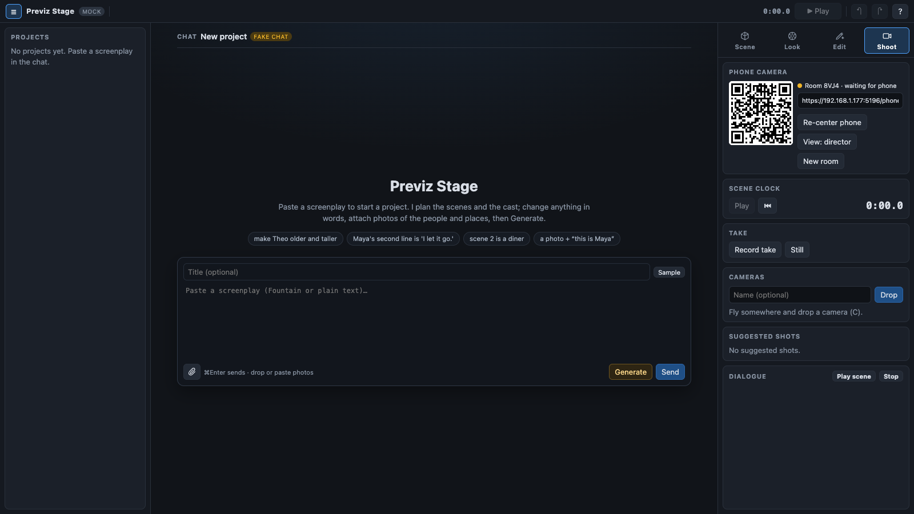
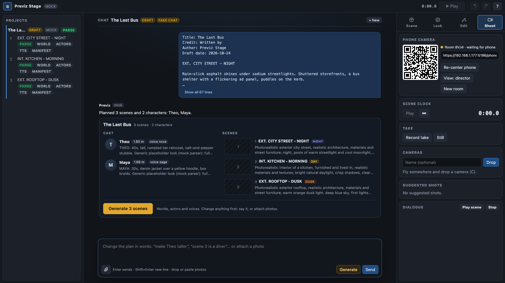
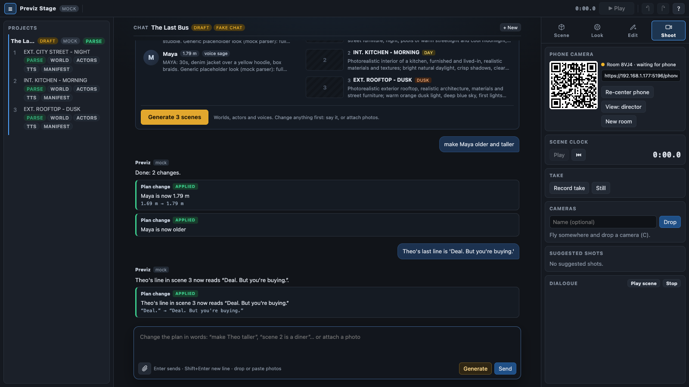
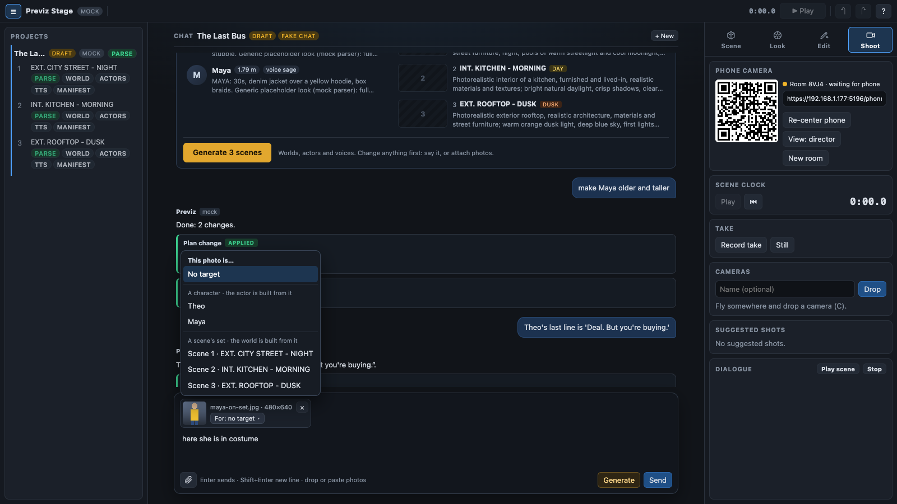
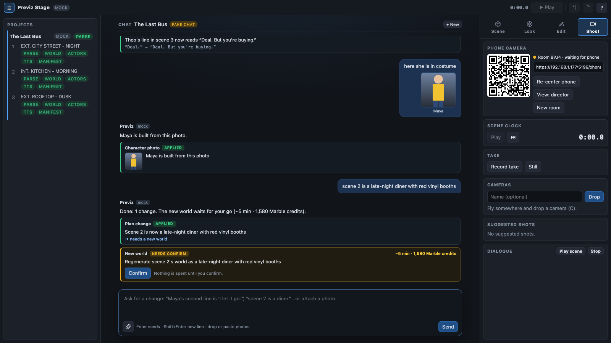
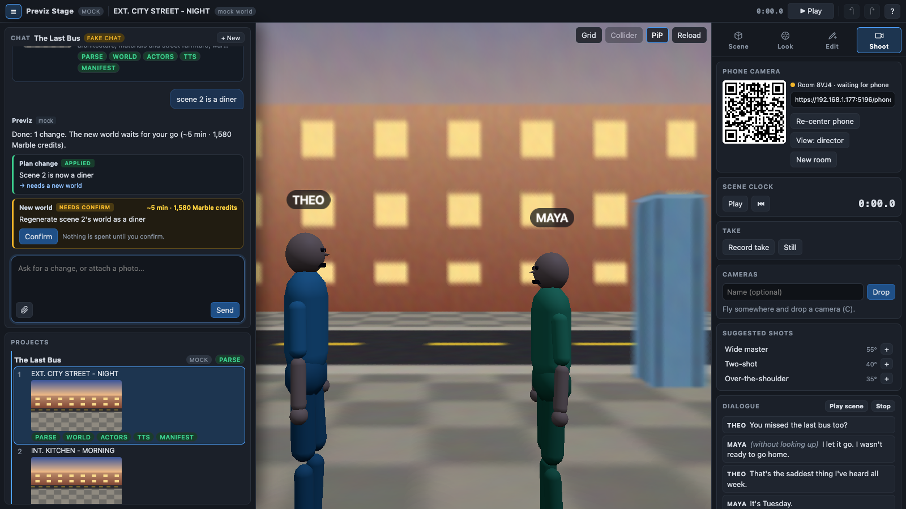

# Previz Stage v2 — look development, scoped re-prompting, intuitive editing, ARKit camera

Builds on docs/PLAN.md. Contracts: `shared/look.ts` (Look + SceneEdit), additions to
`shared/protocol.ts` (SceneState.look / editsRevision) and `shared/api.ts` (reprompt + edits routes).

## 1. Look development on the laptop → identical render on the phone

A **Look** is a small JSON document per scene (`scene-<n>/edits.json`), edited live on the laptop
and broadcast in `SceneState.look`, so the phone — the "final cinematography" view — renders the
same frame the director graded. Everything in a Look is applied at render time; nothing is baked.

| Group | Controls | How it renders |
| --- | --- | --- |
| Exposure & grade | exposure, contrast, saturation, temperature, tint, shadows/highlights | fullscreen post pass (shader) over the composited frame |
| Film | vignette, grain, bloom, LUT presets (neutral, teal-orange, noir, kodak, bleach) | same post pass |
| Atmosphere | fog colour + density, sky tint | per-splat colour program (fog by distance; sky = far + above horizon) + matched three.js fog on meshes |
| Lens | depth of field (focus distance, f-stop), focal length is the camera's | Spark DOF (`focalDistance`, `apertureAngle`) |
| Lights | key/fill/practical: point, spot, sun — position, colour, intensity, radius, cone | three.js lights on mesh actors/props + a Spark world modifier that brightens/tints splats by distance/angle to each light (fake relighting; honest limit: a baked splat cannot cast new shadows) |

"Click to focus": clicking the viewport sets `dof.focusDistance` from the splat raycast hit.
Looks have presets, undo/redo, and a per-camera override (a dropped camera can carry its own lens settings).

## 2. Scoped re-prompting (edit only what the prompt touches)

The director types a prompt ("make the pillow on the left red", "move the car closer", "make the
sky stormy"). The server asks Claude for an **EditPlan**: a scope and a list of typed ops. The
scope decides the cost:

| Scope | Examples | Cost | Mechanism |
| --- | --- | --- | --- |
| `look` | warmer, more contrast, night mood, add a key light from the left | instant | patch Look |
| `transform` | move Leo closer, make the car bigger, rotate the bench | instant | actor / prop / light / camera transform |
| `prop` | add a bicycle leaning on the shelter, remove the bus | instant | DynamicElement add/remove (procedural props; image-to-3D later) |
| `splat-region` | pillow red, remove the lamp, make the plant taller, shift the chair left | instant, no re-render | Spark `SplatEdit` SDF region: colour (multiply / hue / set), opacity 0 (remove), displace (move), scale (grow/shrink via displacement field) |
| `world-regen` | different sky, make it winter, turn the kitchen into a diner | ~5 min + 1,580 credits, **requires confirmation** | re-generate the Marble world: preferred path edits the world's own panorama with an image model (inpaint sky / season) and feeds it to Marble as an image prompt so the layout stays; fallback is the text prompt with the delta |

Rules the planner must follow:
- Choose the **cheapest scope that satisfies the prompt**; never regenerate for something a region edit or a grade can do.
- A `splat-region` op needs a 3D target. Resolution order: (1) the director's click/drag selection in the viewport (raycast on splats); (2) Claude vision on the current render returns a pixel box for the named object, unprojected through a splat raycast at its centre and sized from the box; (3) if neither resolves, ask the director to click the object. Never guess a region silently.
- Every applied edit is appended to `edits.json` with the prompt that produced it; edits are
  individually toggleable/deletable and undoable; a regen replaces the world but keeps edits that
  still make sense (look, actors, props; region edits are dropped with a note).
- The response always says what it did and did not do ("Recoloured 1 region (pillow, 0.4 m). Did not change the sofa.").

## 3. Intuitive laptop editing

- Direct manipulation: drag actors, props, lights and dropped cameras on the floor plane; handles for rotate/scale; snap to floor; shift-drag to raise. Click a splat object to select a region (auto-sized sphere, adjustable), then colour/hide/move it from a mini-toolbar.
- Panels: **Scene** (projects/scenes/actors), **Look** (grade/lens/lights with presets), **Edit** (re-prompt box with history and scope chips), **Shoot** (cameras, phone, dialogue, record). One obvious primary action per panel, hover hints, keyboard cheatsheet (`?`).
- Every edit syncs to the phone within one broadcast; the phone HUD shows the look name.

## 4. ARKit camera app (prototype)

Justified: ARKit's visual-inertial tracking gives true 6DoF position (the browser has none) and a
yaw that does not drift or jump the way `DeviceOrientation` does, so both location and direction
are strictly more accurate. Scope: SwiftUI + ARKit app that joins the same relay room, streams
`PhonePose` with a real `offset` (and `source: 'arkit'`), shows the laptop's scene as a WebView of
`/phone.html?pose=external` (the web renderer, fed poses from the native side) so the look pipeline is
shared, and offers re-centre / shutter / record. Generated with xcodegen; **compiles only once Xcode is
installed** (pending the macOS upgrade); until then it ships as reviewed source.

## 5. Project chat

The screenplay box is the first message of a conversation about the project (contract:
`shared/chat.ts`, routes in `shared/api.ts`). **Send** plans it as a draft (only the parse stage runs,
nothing is spent) and the assistant answers with a plan card; the director amends it in words, attaches
photos of the people and places, and starts the build with **Generate**. After generation the same
thread continues: changes rebuild an actor, re-voice lines, or wait for a confirmed world regeneration.

**Where it lives.** With no scene open the chat fills the viewport (big and readable; it is the first
thing a new director sees). Once a scene opens it docks in the projects drawer above the project list,
and the drawer widens to 452 px over the viewport while the chat is in use (the canvas keeps its size, so
the splats are not re-laid out on every keystroke). Clicking the viewport or a right-hand tab narrows it
again. The same DOM node moves between the two places, so a half-typed message, its photos and the
scroll position survive the move. The four right tabs, the drawer toggle `[` and every viewport
shortcut keep working. The shortcuts are ignored while typing in the chat.

| Part | What it shows / does |
| --- | --- |
| Thread | User bubbles (the screenplay collapsed to its first lines, photo thumbnails captioned with their target); assistant bubbles with the reply, the planner (`mock` / `claude`) and its cost |
| Plan card | Title; the cast (photo or initial, height, voice, description); the scenes (Marble thumbnail or the set photo, heading, time of day, world prompt, stage chips once generating; a ready scene opens on click); a prominent **Generate N scenes** while the project is a draft. Only the latest plan card is drawn in full; older ones collapse to a line |
| Action cards | One per `ChatAction`: kind, status chip (applied / needs confirm / running / done / failed / skipped), summary, `before → after` of a plan patch, effect, note, cost, the photo it used; **Confirm** on needs-confirm (POST chat/confirm) |
| Composer | Auto-growing box. A new project's screenplay takes Enter as a newline (⌘Enter sends); in a thread Enter sends and Shift+Enter adds a newline. Attach button, drag-and-drop and paste of images; chips with a thumbnail, the prepared size and a target picker (none / each character / each scene → the request's `hint`); Sample; **Send** and **Generate** (first message: the pre-chat Generate, everything at once; later: POST /generate after sending what was typed) |
| States | "Thinking" / "Uploading photo 1 of 2" placeholder while a request runs, composer read-only; errors inline with the message given back to the composer; "Reading the screenplay" while the draft parses |

Images are decoded, downscaled to ≤ 1600 px on the long side and re-encoded as PNG in the browser
before upload (inputs over 40 MB are refused before decoding, results over the server's 12 MB limit
after). Photos attached to the very first message are uploaded once the draft exists and sent as the
second message, after the plan is read: uploads need a project id. Their character targets, picked from
the screenplay's cue names before any plan existed, are mapped to the plan's ids.

The thread is server state: refetched when `ProjectStatus.chatRevision` changes, polled with the project
list (every 1.5 s while the draft parses, a request or an action runs). A project without a thread (created
by the pre-chat Generate on an older server) still gets its plan card from `plan.json`. Opening a scene
switches the chat to that scene's project. So does clicking a project's name in the list, and **+ New**
starts another. A draft in progress comes back after a reload.

`?fakechat=1` runs the chat on an in-memory server (`web/src/laptop/chat-fake.ts`): the MOCK planner
rules, the real offline parser, simulated generation and regeneration; real projects stay listed and can
be chatted with without anything reaching the server. The evidence below is that fake in headless
Chromium (`tests/e2e/chat.spec.ts` drives the same flow against the real MOCK server).

## Work packages

| WP | Scope | Owns |
| --- | --- | --- |
| F look | Look post pass, Spark DOF/depth, light modifiers, Look panel, phone render parity, presets/undo | `web/src/viewer/look/**`, `web/src/laptop/look-panel.ts`, `server/pipeline/edits.ts` (persistence), phone look application |
| G reprompt | EditPlan planner (Claude), region resolution (click + vision), SplatEdit application, prop/transform ops, regen via edited pano, history/undo | `server/pipeline/reprompt/**`, `web/src/viewer/edits/**`, `web/src/laptop/edit-panel.ts` |
| H ux | Direct manipulation, panel shell/IA, onboarding, keyboard | `web/src/laptop/**` shell, `web/src/viewer/manipulate/**` |
| I arkit | iOS app source (xcodegen), pose bridge, docs | `ios/**` |
| E2 verify | e2e for look parity + scoped edits (mock planner), real-key smoke, fresh-clone gate | tests |
| WP6 chat UI | Project chat on the laptop: thread, plan card, action cards, composer with photo targets, fake chat server | `web/src/laptop/chat-*.ts`, `chat-panel.css`, `projects-panel.ts`, `tests/e2e/chat.spec.ts` |
